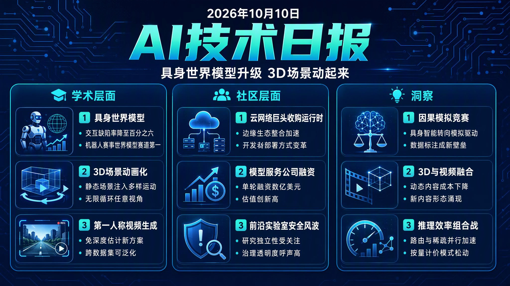

# 🌅 破晓 AI 情报早报 · 2026-10-10（周六）

> 数据来源：HuggingFace Daily Papers · HackerNews · Reddit ML
> 生成时间：2026-10-10

## 📡 学术概览

> 本日 HuggingFace 收录 50 篇论文（10-09 批次），以全模态 RL 缩放、3D 世界模型动态化、端到端视角视频生成、具身世界模型与 LLM 推理系统为核心主题。

### Tier 1 · 核心突破

1. **MiMo-V2.6：Scaling Reinforcement Learning Towards Self-Improvement（MiMo-V2.6：扩展强化学习迈向自我改进）**

   🔬 领域：基础大模型 · 强化学习 · 全模态 · 热度：HF Top 6

   - **一句话核心贡献**：发布全模态模型系列 MiMo-V2.6，从数据、环境、评测三个维度规模化 RL 计算，展示通过"异步训练 + 智能体评分 + 混合任务 Agentic RL"推动模型走向自我改进的完整技术报告。
   - **摘要精译**：
     RL 是推动基础大模型走向自我改进的核心训练范式，但大规模 RL 面临训练稳定性、奖励信号准确性与环境多样性三重瓶颈——现有开源报告很少完整披露如何在算力受限条件下同时扩展这三者。
     本文在预训练 hybrid-SWA 架构之上，沿三条轴扩展 RL 计算：更大批次与更高吞吐（异步训练每步消费 1,568 个样本、2.7-3.7B tokens，上下文最长 1M）；更多元复杂的训练环境（代码、通用、视觉、网络域多 Agent harness 混合）；更多评测计算（基于分组的智能体式评分，为长周期任务提供更准的奖励信号并引导模型输出更短、更省 token 的解法）。为保持大规模训练稳定，团队冻结了 MoE 路由器并建立多层抗奖励黑客防线。
     作为技术报告，论文开源了训练动态、RL 环境与 RL 框架，为社区复现和进一步研究规模化 RL 与模型自我改进提供了基础设施级参考。
   - **核心创新点**：
     1. 三步走策略：多模态中期训练 + 混合 SWA 架构 + 三维度扩展 RL
     2. 分组智能体式评分：长周期任务奖励更准、解法更省 token
     3. 冻结 MoE 路由器 + 多层抗奖励黑客防线保障稳定

   

   
💡 展开详情（方法论 + 实验）

   - **方法细节**：在预训练 hybrid-SWA 架构上先做多模态语料中期训练以提供探索空间；RL 训练采用异步架构（1,568 samples/step、2.7-3.7B tokens/step、上下文最长 1M）；环境覆盖代码/通用/视觉/网络四域；评测侧用分组智能体式评分（groupwise agentic grading）替代单一打分器。
   - **实验结果**：论文聚焦训练方法论与基础设施披露；核心量化指标为每步 1,568 样本、2.7-3.7B tokens、1M 上下文，评测维度含长周期任务奖励准确率与 token 效率（shorter、more token-efficient solutions）。
   - **局限性**：作者署名为 Core Team，未披露模型在其他公开基准上的绝对得分；混合任务 Agentic RL 的实现复杂度高，复现成本大。
   - **链接**：https://arxiv.org/abs/2610.11959

   

2. **LEGO：A Lifting-Free Approach for Exocentric-to-Egocentric Video Generation（LEGO：免提升的外视角到第一人称视角视频生成）**

   🔬 领域：视频生成 · 新视角合成 · 视频扩散模型 · 热度：HF Top 18

   - **一句话核心贡献**：抛弃现有"深度估计 → 点云提升 → 重渲染"的显式重构管线，改用端到端学习的视角合成器直接生成第一人称视角，让视频扩散模型专注于补全细节，在多个数据集上持续超越 SOTA 显式管线且无需重训练即可泛化。
   - **摘要精译**：
     从单段外视角（exocentric）录像生成第一人称（egocentric）视频是视角合成中的难题：两个视角重叠极少、大部分目标视角内容不可见。现有 SOTA 方法通过估计深度、把视频提升成点云、再从第一人称视角重渲染来条件化视频扩散模型。
     本文提出免提升方案：一个类似 LVSM 的 Transformer 视角合成器经微调后直接渲染第一人称视角，无需深度、点云或重投影，由网络内部解决跨视角对应关系。其概率式映射按学习到的对应分布把每个区域在各候选源位置间加权平均，保留结构、平均掉细纹理——论文论证这一取舍恰好适合扩散生成器，因为去噪训练本就擅长恢复细节，条件输入应优先保证结构对齐而非锐度。对应分布的集中度还可作为逐区域置信度，既用于掩蔽低置信区，也在早期布局形成的去噪步骤中引导生成器聚焦高置信区域。
     该方法持续优于 SOTA 显式管线，且无需重训练即可泛化到其他数据集，为外视角→第一人称视频生成提供了更简洁有效的新范式。
   - **核心创新点**：
     1. 免提升管线：LVSM 风格 Transformer 直接渲染目标视角
     2. 结构对齐优先、细节交给扩散模型的分工策略
     3. 置信度引导：掩蔽低置信区 + 早期去噪步聚焦高置信区

   

   
💡 展开详情（方法论 + 实验）

   - **方法细节**：双模型分工——视角合成器（view synthesizer，微调的 LVSM 风格 Transformer）负责生成视角结构，视频扩散模型负责恢复细节；训练时合成器学习"对应分布"式的概率映射，推理时利用分布集中度构造逐区域置信度掩码并参与去噪引导。
   - **实验结果**：在多种外→内视角视频生成基准上一致超越显式深度提升管线（state-of-the-art explicit pipeline），并验证跨数据集零重训练泛化能力；论文未给出单一绝对数字，核心证据是相对基线的系统性优势与泛化性。
   - **局限性**：细纹理在概率映射中被平均掉，极端视差场景下结构对齐仍可能受限；依赖合成器与扩散器的分阶段训练。
   - **链接**：https://arxiv.org/abs/2610.12442

   

3. **OuroWorld：Bringing Any 3D World Alive as Diverse, Endlessly Looping 3D Cinemagraphs（OuroWorld：让任意 3D 世界动起来的无限循环 3D 动态影像）**

   🔬 领域：3D 世界模型 · 视频生成 · 4D 场景 · 热度：HF Top 11

   - **一句话核心贡献**：提出免掩码框架 OuroWorld，把任意静态 3D Gaussian Splatting 场景变成可任意视角观看、运动多样且无缝循环的 3D 动态影像（cinemagraph），在 39 个场景上以 70.8%-99.0% 的用户研究胜率全面超越基线。
   - **摘要精译**：
     现有 3D 世界模型能生成照片级真实、可自由探索的场景，但画面"定格在时间里"——缺少生动、可控且连续循环的运动。把静态 3D 场景赋予动态是 4D 内容生成的核心挑战，而监督信号天然不完美（场景运动无从真值获取）。
     OuroWorld 先用视觉语言模型推断场景的合理动态，指导视频模型合成参考视频，再将其提升并补全为多视角视频；为从这种不完美监督中学习，提出对不一致鲁棒的周期性 4DGS（Inconsistency-Robust Periodic 4DGS）：傅里叶级数形变场从构造上保证循环，锚定在参考视角的接地区移场（Grounded Drift Field）吸收跨视角不一致。与仅支持流体类运动的传统欧拉方法不同，本方法能刻画一般形变、物体运动与光照变化。
     在 39 个重建与生成场景上，OuroWorld 全面超越所有基线，用户研究胜率 70.8%-99.0%，并引入无需真值的评估指标（生动性、自然度、循环接缝一致性、场景质量）。
   - **核心创新点**：
     1. 免掩码框架：VLM 推断动态 + 视频模型合成参考 + 多视角补全
     2. 周期性 4DGS 形变场从构造上保证无缝循环
     3. 引入无真值评估体系覆盖生动性/自然度/接缝一致性

   

   
💡 展开详情（方法论 + 实验）

   - **方法细节**：两阶段——(1) VLM 基于静态 3DGS 场景推断合理动态并引导视频模型生成参考视频；(2) 将参考视频提升为多视角视频并补全不可见区域；核心模块为 Inconsistency-Robust Periodic 4DGS（傅里叶形变场 + 参考视角锚定漂移场）。
   - **实验结果**：39 个重建/生成场景上全面超越基线；用户研究对比胜率 70.8%-99.0%；支持一般形变、物体运动与光照变化（超越流体类运动的欧拉方法）；项目页 https://ouroworld.userwei.com
   - **局限性**：运动多样性依赖 VLM 推断质量；对需要物理精确（非合理即可）动态的工业级场景未必够用。
   - **链接**：https://arxiv.org/abs/2610.12461

   

4. **DreamTrue：Action-Faithful Robot World Model with Counterfactual Post-Training（DreamTrue：带反事实后训练的具身机器人世界模型）**

   🔬 领域：具身智能 · 视频预测 · 世界模型 · 热度：HF Top 9 · AgiBot World Challenge 2026 世界模型赛道第一

   - **一句话核心贡献**：提出多视角、跨本体（cross-embodiment）的机器人世界模型 DreamTrue，通过离线几何标定提升动作跟随能力、反事实后训练扩大交互覆盖、视频奖励模型引导强化学习，将人类评估的交互缺陷率从 48.12% 降至 6.25%。
   - **摘要精译**：
     机器人世界模型要求"动作保真"（按给定动作生成未来画面）与"物理合理"兼备，但现有机器人数据集存在两大障碍：相机标定不精确会损害动作跟随，且失败交互样本覆盖不足会让模型偏向预测成功结果。
     针对动作跟随，本文把动作轨迹渲染为图像空间条件，并引入离线几何标定使条件与目标视频对齐，从而跨本体泛化；针对交互覆盖，提出反事实后训练——修改记录中的动作轨迹并生成更广泛动作与接触配置下的未来视频。为了在无配对真值的情况下为这些预测提供反馈，团队构建了覆盖机器人、物体、交互缺陷的人类标注视频数据集，训练具身视频奖励模型，其评分引导强化学习后训练走向更物理合理的交互结果。
     在 AgiBot 基准上，DreamTrue 取得 SOTA 动作跟随，并将人类评估的交互缺陷率从 48.12% 降至 6.25%，在世界模型赛道拿下 AgiBot World Challenge 2026 第一名。
   - **核心创新点**：
     1. 动作轨迹渲染为图像条件 + 离线几何标定提升跨本体泛化
     2. 反事实后训练扩大失败交互覆盖，纠正成功偏置
     3. 具身视频奖励模型驱动的 RL 后训练

   

   
💡 展开详情（方法论 + 实验）

   - **方法细节**：将动作轨迹渲染进图像空间作为条件输入；离线几何标定（offline geometric calibration）对齐条件与目标视频；修改录制动作构造反事实并以更宽动作/接触配置生成未来视频；人类标注缺陷数据集（机器人/物体/交互三类缺陷）+ 具身视频奖励模型评分 → 强化学习后训练。
   - **实验结果**：AgiBot 基准动作跟随 SOTA；人类评估交互缺陷率 48.12% → 6.25%；AgiBot World Challenge 2026 世界模型赛道第一名；项目页 https://brave-eai.github.io/DreamTrue
   - **局限性**：依赖人类标注构建奖励模型，扩展新任务成本较高；反事实生成质量上限受视频生成模型能力约束。
   - **链接**：https://arxiv.org/abs/2610.12468

   

5. **MC-Sparse：Deconstructing and Closing the Dense-Sparse Attention Gap in Diffusion Transformers（MC-Sparse：拆解并弥合扩散 Transformer 中稀疏注意力的质量差距）**

   🔬 领域：视频生成 · 3D 资产生成 · 推理加速 · 热度：HF Top 13

   - **一句话核心贡献**：通过受控对照实验定位稀疏注意力质量退化的三个根源，提出免训练框架 MC-Sparse（元缓存稀疏注意力），在 Minimax-H3-Base 上实现 1.80 倍、3D 资产生成 2.32 倍去噪加速且无可见质量损失。
   - **摘要精译**：
     稀疏注意力是降低扩散 Transformer 在长序列生成（视频、高分辨率 3D 资产生成）中延迟的首选手段，但现有方法在高稀疏度下会明显劣化生成质量与保真度，且原因不清。
     本文通过受控"oracle 对照"实验将质量退化追溯到三个来源：token 分组施加的约束、交互选择不精确、以及 token 被丢弃时损失的注意力贡献。基于该分析提出 MC-Sparse：免训练地在按 tile 对齐分组相似查询的同时，为每个查询独立挑选 key-value token，并将查询分组、按精确注意力概率选出的 KV 索引、以及稠密与稀疏注意力输出之间的残差作为元数据缓存，跨去噪步骤复用。
     在视频与 3D 生成模型上，MC-Sparse 相比现有稀疏注意力基线，对稠密注意力输出的保真度更高、去噪加速更大；相对稠密注意力在 Minimax-H3-Base 上取得 1.80 倍去噪加速、3D 资产生成 2.32 倍加速，质量损失可忽略。
   - **核心创新点**：
     1. Oracle 对照实验拆解稀疏注意力退化三根源
     2. 查询分组建 tile 对齐 + 按精确概率挑选 KV，兼顾效率与保真
     3. 元数据缓存（查询组/KV 索引/残差）跨步复用

   

   
💡 展开详情（方法论 + 实验）

   - **方法细节**：训练无关（training-free）框架；将相似查询组织成 tile 对齐的组以利用 GPU 高效执行，同时为每个 token 独立选择 KV；缓存查询分组、由精确注意力概率选择的 KV 索引、稠密-稀疏输出残差，在后继去噪步骤复用，避免重复计算。
   - **实验结果**：Minimax-H3-Base 上 1.80 倍去噪加速、3D 资产生成 2.32 倍加速（相对稠密注意力），无可见质量退化；在视频与 3D 生成模型上均超越现有稀疏注意力基线。
   - **局限性**：加速比在超长序列上更显著，短序列收益有限；依赖注意力稀疏模式在步间的一致性。
   - **链接**：https://arxiv.org/abs/2610.06801

   

6. **TokenRouter：Efficient Serving System for Token-Level LLM Routing（TokenRouter：Token 级 LLM 路由的高效推理服务系统）**

   🔬 领域：推理系统 · LLM 路由 · 服务优化 · 热度：HF Top 2

   - **一句话核心贡献**：提出开发者友好、面向 Token 级路由推理的服务系统 TokenRouter，让开发者在单请求视角描述路由逻辑、运行时异步分发，解码吞吐相对现有系统提升 2.01-64.15 倍。
   - **摘要精译**：
     LLM 路由把推理任务分布到不同模型上，持续推进服务推理的成本-质量帕累托前沿；粗粒度（会话级/查询级）路由已广泛用于生产，最新算法研究显示细粒度 Token 级路由可带来可观效率与质量收益，但现有系统基于"单 LLM"假设，在 Token 级路由下存在严重的步骤失同步（step desynchronization）和频繁的批量准入延迟，且给开发者带来高实现复杂度。
     TokenRouter 遵循"请求中心编程、模型中心执行"原则：开发者从单个请求的视角描述路由逻辑，运行时为每个 LLM 启动一个子服务并异步分发请求；每个子服务采用延迟批处理调度器，其最优超参由系统吞吐数学模型推导得出。
     在多种路由算法、负载与模型组合下，TokenRouter 的解码吞吐比现有系统高 2.01-64.15 倍，显著推进了 Token 级 LLM 路由的服务效率。
   - **核心创新点**：
     1. 请求中心编程、模型中心执行的开发范式
     2. 基于吞吐数学模型的延迟批处理调度器
     3. 消除步骤失同步与批量准入延迟

   

   
💡 展开详情（方法论 + 实验）

   - **方法细节**：开发侧用单请求视角描述路由逻辑（request-centric programming）；运行侧为每个 LLM 建立子服务（subserver）异步分发（model-centric execution）；调度器采用 delayed-batching，超参由吞吐模型闭式推导；代码已开源 https://github.com/thu-nics/TokenRouter
   - **实验结果**：跨多样化路由算法/负载/模型组合，解码吞吐较现有系统提升 2.01-64.15 倍。
   - **局限性**：收益依赖路由算法本身的 Token 级调度粒度与场景；子服务架构的部署复杂度和显存开销高于单模型服务。
   - **链接**：https://arxiv.org/abs/2610.12242

   

### Tier 2 · 工程改进

7. **SuperNav：An Agentic Navigation System for Any Task in Any Scene（SuperNav：任意任务任意场景的智能体导航系统）**

   🔬 领域：具身智能 · 导航 · MLLM Agent · 热度：HF Top 5

   - **一句话核心贡献**：让预训练 MLLM 专注"理解任务与场景、做决策"，把运动执行交给导航工具，无需导航数据微调即可在实例级、多目标与需求驱动型导航任务上超越四个基线。

   

   
💡 展开详情

   - **方法细节**：为预训练 MLLM 装配专用 agent harness（Navigation Skills + agent-oriented Tools + 任务进度/上下文管理），统一视觉-点接口让模型直接在图像中标定目标点，并从执行反馈中修正决策。
   - **实验结果**：在 HM3D 类别级评估与真实四足机器人部署上均验证通用性，全面优于四个基线模型。
   - **局限性**：MLLM 的决策能力与工具链的成熟度共同决定上限。
   - **链接**：https://arxiv.org/abs/2610.12126

   

8. **WorldGuide：Goal-Directed Video World Model for Procedural Task Execution（WorldGuide：面向程序化任务执行的目标导向视频世界模型）**

   🔬 领域：视频生成 · 世界模型 · 长视野任务 · 热度：HF Top 42

   - **一句话核心贡献**：把程序化任务视频生成建模为闭环任务执行——给定初始图像与目标，规划器预测下一个原子动作、执行器生成对应视频片段、模型根据生成结果决定继续或终止，以 33.33% 任务成功率超越带参考动作规划的最强视频模型 MiniMax-H3（29.90%）。

   

   
💡 展开详情

   - **方法细节**：Planner 与 Executor 在同一逐步演示数据上联合训练，前者从视觉进度预测下一原子动作或任务完成，后者直接学习实现预测动作；层级视觉记忆在长视野执行中维持状态、控制历史 token 成本；发布 WorldGuide Bench（约 5.9 万逐步标注视频、245 任务、27 类程序化任务）。
   - **实验结果**：WorldGuide-Bench 任务成功率 33.33% vs MiniMax-H3 29.90%（后者还获得参考动作规划）；VideoCraft-Bench 47.69% vs 32.73%。
   - **局限性**：任务成功率仍偏低（~1/3），程序化任务覆盖面与视频质量是下一步瓶颈。
   - **链接**：https://arxiv.org/abs/2610.12459

   

9. **TestPrism：Rethinking Test Evaluation Beyond a Single Reference（TestPrism：超越单一参考答案的测试评估新范式）**

   🔬 领域：代码生成 · 测试评估 · LLM Agent · 热度：HF Top 12

   - **一句话核心贡献**：构建 300 个测试任务、3,000 个候选实现的 TestPrism 基准，暴露"单一参考答案"评估的虚高问题——联合成功函数仅 28.00%，而单参考成功率达 59.67%，并配套 TestHelix 修复管线。

   

   
💡 展开详情

   - **方法细节**：联合成功函数要求测试在初始程序状态上失败、接受所有合法实现、拒绝所有非法实现；TestHelix 结合异构测试-修复对合成、同行交叉验证与递归自我改进（RSI）。
   - **实验结果**：14 个编码 Agent 配置中联合成功函数仅 28.00%（单参考 59.67%）；TestHelix 在两个模型上提升 8.67-9.00 个百分点。
   - **局限性**：修复管线收益在原生比较器上约 +9 个百分点，仍远未饱和。
   - **链接**：https://arxiv.org/abs/2610.12289

   

10. **SparseDecoding：Decoding-Aware Pruning for Accurate and Efficient LLM Inference（SparseDecoding：面向解码感知的 LLM 剪枝加速）**

   🔬 领域：推理效率 · 模型剪枝 · 稀疏计算 · 热度：HF Top 17

   - **一句话核心贡献**：针对解码阶段"内存受限"特性设计解码感知剪枝框架：用自回归生成过程中的激活构造校准矩阵消除预填充/解码分布偏移，配合优化的 N:M 稀疏矩阵-向量内核，端到端解码加速最高 1.48 倍且精度不降。

   

   
💡 展开详情

   - **方法细节**：算法侧用稠密模型自回归生成（排除 prefill）的分层激活构造校准矩阵；系统侧实现带位掩码索引与固定步长遍历的 N:M 稀疏 SpMV 内核。
   - **实验结果**：Llama-3.1-8B / Llama-3.3-70B / Qwen3-14B / 32B 上长文生成一致优于固定文本校准剪枝，A100 端到端解码加速最高 1.48 倍。
   - **局限性**：N:M 结构化稀疏要求硬件/内核生态配合。
   - **链接**：https://arxiv.org/abs/2610.12327

   

---

## 🔥 社区速递

### 热点事件

1. **Cloudflare 收购 Deno：浏览器原生运行时并入云网络巨头**

   🔥 热度信号：HackerNews Score 993 · Top 1 · 来源：deno.com

   - **一句话核心**：Cloudflare 正式收购 Deno 公司，把 Deno 运行时、JSR 生态与 TypeScript 原生执行能力纳入自家网络与边缘计算版图。
   - **核心共识**：
     1. Deno 的孤立运行时 + Cloudflare 的全球边缘网络是"运行时即平台"的战略互补，TypeScript 原生执行有望在边缘直接落地
     2. 对 JS/TS 开发者而言，Deno 生态（JSR、Deno Deploy）将更快获得规模化基础设施支持
     3. 此举延续 Cloudflare "网络为王" 的整合路线（此前已收购 PartyKit 等运行时团队）
   - **主要争议**：Deno 独立品牌与开源中立性会被 Cloudflare 平台绑定侵蚀多少？
   - **影响评估**：对开发者影响直接——若 Deno 运行时深度整合进 Cloudflare Workers，边缘 JavaScript/TypeScript 部署的成本与形态将改变；运行时类初创公司（如 Bun）与云厂商的并购窗口被再次打开。

2. **OpenAI 解雇三名安全研究员，当事人反驳并警告寒蝉效应**

   🔥 热度信号：HackerNews Score 300 · Top 10 · 来源：TechCrunch

   - **一句话核心**：OpenAI 以"处理研究信息不当"为由解雇三名安全研究员，被解雇者公开反驳指控，并警告此举将压制 AI 安全研究的内部发声。
   - **核心共识**：
     1. AI 前沿实验室的安全研究与公司治理之间的张力再次成为焦点——"异议者文化"如何在不损害安全工作的前提下存在
     2. 当事研究员称解雇理由与事实不符，事件证据披露不足引发社区质疑
     3. OpenAI 近期多次安全团队人事震荡，行业对其安全承诺的信心受影响
   - **主要争议**：这是合理的内部信息管理，还是对安全研究独立性的打压？
   - **影响评估**：对 AI 从业者而言，安全研究岗位的"职业风险"叙事被强化；监管部门与公众对前沿实验室内部治理透明度的要求会继续上升。

3. **Show HN：让 AI Agent 在你的屏幕上画大箭头、框和文字**

   🔥 热度信号：HackerNews Score 361 · Top 8 · 来源：GitHub

   - **一句话核心**：开源工具 big-arrow-on-the-screen 让 AI Agent 以图形叠加的方式在屏幕上直接绘制方向箭头、选框与文字指引，解决"Agent 操作 GUI 时用户不知道它在做什么"的可视化问题。
   - **核心共识**：
     1. Agent 屏幕标注是 GUI 自动化（computer use）类产品的实用配套能力，能显著提升人机协作的可理解性
     2. 实现方式轻量（叠加层绘制），与现有 Agent 框架可快速集成
     3. HN 高赞反映出社区对"Agent 可观测性"痛点的共鸣
   - **主要争议**：屏幕叠加标注与无障碍/辅助功能（如读屏软件）的冲突如何解决？
   - **影响评估**：为正在构建桌面与浏览器 Agent 的团队提供了即插即用的可视化组件；GUI Agent 的"透明度"将成为产品竞争的新维度。

4. **Typesafe AI 融资 8.7 亿美元，估值 75 亿美元**

   🔥 热度信号：HackerNews Score 215 · Top 13 · 来源：typesafe.ai

   - **一句话核心**：Typesafe AI 完成 8.7 亿美元融资，投后估值 75 亿美元，跻身 AI 基础设施融资头部梯队。
   - **核心共识**：
     1. AI 模型部署与治理类基础设施仍是资本重仓方向，资金持续向"规模化落地"集中
     2. 75 亿美元估值表明市场对"模型生命周期安全与合规"价值的认可
     3. 该轮融资规模在同类 AI 基础设施公司中处于第一梯队
   - **主要争议**：高估值能否匹配实际营收增速，AI 基础设施赛道是否存在估值泡沫？
   - **影响评估**：AI 基础设施创业公司估值锚点被抬高；企业客户对该类服务的采购信心增强，行业整合（收购/并购）预计加速。

5. **Microsoft-Decision-1：微软发布快速决策模型**

   🔥 热度信号：HackerNews Score 112 · Top 20 · 来源：commandline.microsoft.com

   - **一句话核心**：微软发布 Microsoft-Decision-1，一个面向"快速决策"场景的推理模型，主打低延迟、适合命令行与轻量自动化场景的决策生成。
   - **核心共识**：
     1. "小模型 + 低延迟决策"路线成为大厂补齐推理场景拼图的常见打法，与通用大模型形成互补
     2. 面向命令行/开发工作流集成是差异化卖点，契合开发者日常自动化需求
     3. 微软持续在 Foundry 模型家族中扩张专用小模型
   - **主要争议**：快速决策模型的"决策质量"与通用推理模型相比到底有多少差距？
   - **影响评估**：为开发者在成本敏感、延迟敏感场景提供了新选项；专用小模型与通用大模型的分层供应格局进一步固化。

6. **MXC：微软开源的沙箱代码执行系统**

   🔥 热度信号：HackerNews Score 174 · Top 14 · 来源：GitHub

   - **一句话核心**：微软开源 MXC，一个面向代码执行的安全沙箱系统，为 Agent 与自动化任务提供隔离的代码运行环境。
   - **核心共识**：
     1. 沙箱执行是 AI Agent 落地安全性的必备组件，微软开源补齐了企业级安全执行的开源选项
     2. 沙箱与 Agent 框架的集成方式（代码解释器替代）是社区讨论焦点
     3. 开源后可能成为 Agent 工具链的安全执行标准候选
   - **主要争议**：沙箱的逃逸防护强度能否经受真实攻击检验？
   - **影响评估**：为 Agent 开发者提供了企业级的开源沙箱选择，降低"让 Agent 执行代码"的安全顾虑，可能加速 Agent 自动化落地。

---

## 💰 商业动态

- **Cloudflare 收购 Deno（HN 993 分）**：云网络巨头把 Deno 运行时与 JSR 生态收入麾下，边缘计算 + TypeScript 原生执行的组合将重塑"无服务器 + 运行时"的商业格局；对 Bun 等同类运行时初创形成估值与并购参照。
- **Typesafe AI 融资 8.7 亿美元（估值 75 亿美元）**：AI 基础设施赛道再获巨额注资，模型部署、治理与合规类服务的资本热度持续，头部公司估值锚点进一步抬高。
- **Oxide Computer 完成 4.45 亿美元 D 轮融资（HN 547 分）**：云硬件初创公司获大额融资，反映 AI 算力需求向"私有云基础设施"迁移的趋势，为自建/自营算力的企业提供新选择。
- **AI Agent 可视化与沙箱工具开源潮**：big-arrow-on-the-screen（Agent 屏幕标注）与微软 MXC（沙箱代码执行）同日登顶 HN，Agent 工程化配套工具链成为开源生态热点，间接带动 Agent 相关商业服务需求。

---

## 📊 今日总结

1. **具身世界模型进入"动作保真 + 物理合理"双达标阶段**：现象层面，DreamTrue 把机器人世界模型的人类评估交互缺陷率从 48.12% 压到 6.25% 并夺得 AgiBot World Challenge 2026 世界模型赛道第一，同时 SuperNav、WorldGuide 分别在导航与程序化任务视频上推进"规划-执行闭环"；逻辑上，纯视觉预测已无法满足机器人落地需求，社区正用几何标定、反事实数据与奖励模型把"世界模型"从演示复读机改造成可被动作驱动的因果模拟器；预测未来半年，具身世界模型将沿着"跨本体泛化 + 长视野闭环"两条线继续逼近可用性门槛，仿真数据与人类标注的质量将成为新的军备竞赛点。综上，具身智能正从"感知竞赛"转入"因果模拟竞赛"。

2. **视频生成与 3D 的边界正在消融，生成走向"任意视角、任意时长、无缝循环"**：现象层面，OuroWorld 让任意静态 3D 场景带上多样、无限循环的运动（用户研究胜率 70.8%-99.0%），LEGO 实现免深度估计的外视角到第一人称视频生成，WorldGuide 则把视频生成变成闭环任务执行器；逻辑上，3D 场景重建精度与视频扩散模型细节恢复能力的双双成熟，使两条技术路线从"互相独立"走向"互相借用"——3D 提供结构与多视角一致性，视频模型提供运动与细节；预测未来，2D 视频生成与 3D/4D 内容生产的工具链将加速合并，交互式动态场景（游戏、数字人、影视预演）的生成成本会显著下降，OuroWorld 的"3D cinemagraph"很可能成为下一个爆款内容形态。综上所述，视频 AI 的下一个增量机会在"3D 动起来"。

3. **推理效率竞赛进入"路由 + 稀疏 + 减解码"的组合战**：现象层面，TokenRouter 用 Token 级路由把解码吞吐提升 2.01-64.15 倍，MC-Sparse 为视频/3D DiT 带来 1.8-2.32 倍去噪加速，SparseDecoding 面向解码阶段剪枝再获最高 1.48 倍端到端加速；逻辑上，模型能力趋向同质化的背景下，单位 token 成本与延迟成为落地差异化的主战场，而三者分别从"跨模型调度""注意力计算""权重存储"三个维度攻击同一问题，且都强调"训练无关、系统级优化"；预测未来，这些技术将沿着"分层组合"路线整合进推理引擎（路由层在外、稀疏内核在内），使边缘与移动端跑更大模型成为可能，推理成本曲线会被进一步压平。对开发者而言，"按 token 计价"的服务将被迫转向更精细、更高效的计价模型。
