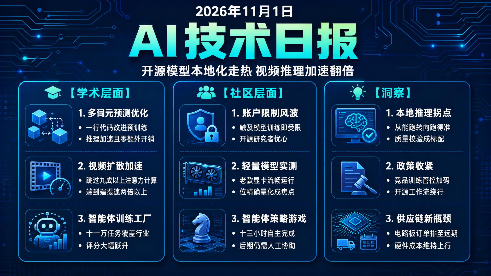

# 🌅 破晓 AI 情报早报 · 2026-11-01（周日）

> 数据来源：HuggingFace Daily Papers（2026-10-30 批次，最新已发布批次）· HackerNews · Reddit LocalLLaMA
> 生成时间：2026-11-01 07:00（北京时间）

---

## 📡 学术概览

> 本日 HuggingFace Daily Papers 最新已发布批次为 2026-10-30（11-01 早间查询时 10-31 / 11-01 批次尚未上线），本批次共 39 篇。本次选题避开前日早报已覆盖的 L3G-World、Platonic JEPA、WeVisCut 等条目，聚焦本批次中尚未解读的代表性工作。核心主题：MTP 预训练梯度的"正确打开方式"、视频扩散推理的稀疏注意力加速、Agent 训练数据的规模化工厂、多模态交错生成的真实数据基准，以及"量化模型到手即坏"与 Agentic 编码评测等工程与评测进展。

### Tier 1 · 核心突破

1. **Multi-Token Prediction Done Right（Soft-MTP：把多词元预测做到位）**

   🔬 领域：基础模型 · 预训练 · 投机解码 · 热度：HF Daily Papers（10-30 批次）

   - **一句话核心贡献**：发现标准多词元预测（MTP）训练里一个残差梯度分量会同时干扰 next-token 与多词元学习且随规模加剧，提出 KL 梯度恢复技巧（Soft-MTP）——一行代码改动、零参数零开销，在 167M 到 1.2B 的每个尺度上都降低 NTP 困惑度、加速投机解码并提升零样本准确率，被作者称为"MTP 优化的免费午餐"。
   - **摘要精译**：
     多词元预测（MTP）已是语言模型预训练的常见组件，既能提升下游性能，又能通过投机解码加速推理。但标准 MTP 训练存在缺陷：MTP 交叉熵梯度可以精确分解为两项——一项是 KL 自蒸馏项，它把每个 MTP 头拉向模型自身的 next-token 预测（NTP）分布、从而改善投机解码；另一项是低信噪比的残差项，它对 next-token 与多词元学习都有干扰，且问题随模型规模放大。
     论文提出 KL 梯度恢复技巧：当两个分布共享同一个线性输出头时，二者 KL 散度的梯度可以通过直通梯度路由，由它们的交叉熵梯度精确组合恢复出来。与直接最小化 KL 不同，该技巧不需要词表大小的 logit 矩阵，兼容标准的融合交叉熵内核。由此得到 Soft-MTP——对标准 MTP 的一行代码改动：剔除噪声残差，只回传 KL 自蒸馏信号，且完全复用现有的 NTP 与 MTP 交叉熵计算。
     实验覆盖 167M 到 1.2B 参数：Soft-MTP 在每个尺度上都优于标准 MTP——更低的 NTP 困惑度、更快的投机解码、更高的零样本准确率；从 689M 起 MTP 困惑度也更低；1.2B 模型微调后数学与代码推理更强。Soft-MTP 同时支持 DeepSeek 式与 Meta 式 MTP，且多数指标不逊于甚至超过直接 KL 散度最小化。
   - **核心创新点**：
     1. 精确定位 MTP 残差梯度干扰
     2. 直通梯度精确恢复 KL 项
     3. 一行代码的预训练免费午餐

   

   
💡 展开详情（方法论 + 实验）

   - **方法细节**：MTP 交叉熵梯度 = KL 自蒸馏项（MTP 头 → 模型自身 NTP 分布，利于投机解码）+ 低信噪比残差项（干扰 NTP/MTP 学习）。KL 梯度恢复：共享线性输出头的两个分布，其 KL 梯度可由二者交叉熵梯度经 straight-through 梯度路由组合精确还原，无需词表级 logit 矩阵，可直接跑在标准 fused cross-entropy 内核上。Soft-MTP 即在此思路下对 MTP 做一行代码改动，兼容 DeepSeek- 与 Meta- 风格 MTP，不新增参数。
   - **实验结果**：167M / 369M / 689M / 1.2B 四个尺度：NTP 困惑度均更低、投机解码更快、零样本准确率全尺度更高；689M 起 MTP 困惑度也更低；1.2B 微调后数学与代码推理更强；多数指标匹配或超过直接 KL 最小化。
   - **局限性**：实验规模止步 1.2B，"越大越好"尚需更大模型验证；对已部署的不同 MTP 实现（如不同损失配方）的兼容性未逐一验证。
   - **链接**：https://arxiv.org/abs/2610.38331

   

2. **AB-Attention: Accurate Block Attention for Accelerating Video Diffusion Transformers（AB-Attention：加速视频扩散 Transformer 的精确分块注意力）**

   🔬 领域：视频生成 · 推理加速 · 稀疏注意力 · 热度：HF Daily Papers（10-30 批次）

   - **一句话核心贡献**：提出无需训练的 AB-Attention，用"块内聚类选择器 + 包含概率加权采样 + 张量核精化"在高稀疏度下精确近似稠密注意力——在 Wan2.1 与 HunyuanVideo 上跳过 89–92% 的注意力计算，PSNR 比最强基线最高提升 4.4 dB，端到端加速最高 2.23 倍。
   - **摘要精译**：
     视频扩散 Transformer 能生成高质量视频，但 3D 全注意力的二次方开销主导推理成本。动态分块稀疏注意力通过只在当前激活选出的键值块上计算精确注意力来降本，但激进稀疏下保真度明显退化：块重要性要么用粗糙摘要打分，要么靠昂贵的全局聚类；被剪掉的块会从 softmax 中消失；整块被整体保留或丢弃，即使其中只有少数键相关。
     论文提出训练免费的 AB-Attention，在高稀疏度下精确近似稠密注意力。其块内聚类选择器（IBCS）只在每个查询块内部做聚类来估算块重要性，不置换 token，既忠实又廉价；包含概率加权采样（SIP）按估算比例采样块，再按包含概率的倒数加权，用一次前向就估计出稠密注意力而非截断它；最后用内核把远小于 tile 的键值块聚合成完整张量核 tile，在不增加张量核开销的前提下精化选择粒度。
     在 Wan2.1 与 HunyuanVideo 上，AB-Attention 跳过 89–92% 的注意力，而基线方法的实际计算量是其 1.8–3.6 倍；同时比最强基线 PSNR 最高提升 4.4 dB，端到端加速最高达 2.23 倍。
   - **核心创新点**：
     1. 块内聚类低成本估算重要性
     2. 包含概率加权单遍估计注意力
     3. 零额外张量核开销的块精化

   

   
💡 展开详情（方法论 + 实验）

   - **方法细节**：三个组件：IBCS（块内聚类选择器）——在同一查询块内聚类、不置换 token，估出忠实且廉价的块重要度；SIP（包含概率加权采样）——按重要度比例采样并做逆包含概率重加权，单遍估计稠密注意力而非直接截断；内核层把远小于 tile 的 K/V 块聚合为完整 tensor-core tile，以零额外张量核成本细化选择。
   - **实验结果**：Wan2.1 与 HunyuanVideo 上跳过 89–92% 注意力（基线计算量为 AB-Attention 的 1.8–3.6 倍），PSNR 较最强基线最高 +4.4 dB，端到端最高 2.23× 加速，代码开源（github.com/InfRec-Cardinal/AB-Attention）。
   - **局限性**：依赖动态路由的额外开销未被单独量化；摘要未披露长视频或超过 92% 稀疏度下的画质边界。
   - **链接**：https://arxiv.org/abs/2610.39663

   

3. **WorkFactory: Turning Professional Intents into Executable Work for Scalable Agent Training（WorkFactory：把职业意图变成可执行任务，规模化 Agent 训练）**

   🔬 领域：Agent · 数据工程 · 后训练 · 热度：HF Daily Papers（10-30 批次）

   - **一句话核心贡献**：提出 WorkFactory 框架，从职业意图出发用"信息支持图 + 探针执行修复"构建连贯且可执行的专业任务，产出覆盖 612 种职业的 112,686 个任务，微调得到 WorkPilot 家族（4B / 27B / 35B-A3B），其中 WorkPilot-35B-A3B 在 GDPval-AA v2.1 上 Elo 从 879 跃升至 1565。
   - **摘要精译**：
     规模化 Agent 的监督训练需要多样化、能产出可靠专家演示的专业任务。但任务信息缺失或不一致会阻碍"教师"模型的执行，从而削弱监督质量——这是规模化数据构建中的核心障碍。
     论文提出 WorkFactory：从职业意图出发，先做信息级规划，构建一张信息支持图来指导任务实例化，显式表示完成任务目标输出所需信息的依赖关系与存放位置；随后用探针执行发现支持性失败并引导修复，同时保留原本的工作意图，保证任务既连贯又可执行。
     实验上，WorkFactory 构建了覆盖 612 种职业的 112,686 个任务，并用收集的教师轨迹微调 Qwen 4B、27B、35B-A3B，得到 WorkPilot 家族：三个模型在四个专业工作基准上均优于各自的基础模型，WorkPilot-35B-A3B 在 GDPval-AA v2.1 上 Elo 从 879 升到 1565。扩展性分析显示收益随规模递减，执行长度则先增后减；受控组件分析表明，规划与修复能减少探针诊断出的任务环境缺陷并提升下游表现。
   - **核心创新点**：
     1. 信息支持图显式建模任务依赖
     2. 探针执行驱动失败修复
     3. 11 万任务覆盖 612 种职业

   

   
💡 展开详情（方法论 + 实验）

   - **方法细节**：管线 = 职业意图 → 信息级规划（构建信息支持图，表达信息依赖与位置）→ 任务实例化 → 探针执行（发现支持失败并修复，保留工作意图）→ 教师轨迹收集 → 用轨迹做 SFT 微调 Qwen 系列。
   - **实验结果**：112,686 任务 / 612 职业；WorkPilot-35B-A3B 在 GDPval-AA v2.1 上 Elo 879→1565，四个专业工作基准全面优于基础模型；扩展分析显示收益递减、执行长度先增后减；数据与模型开源（github.com/IQuestLab/WorkFactory）。
   - **局限性**：任务质量强依赖教师模型与意图来源的多样性；612 种职业相对真实职场空间仍稀疏，跨语言、跨文化任务未覆盖。
   - **链接**：https://arxiv.org/abs/2610.37161

   

4. **IntReal: A Real-World Dataset and Benchmark for Multimodal Interleaved Generation（IntReal：多模态交错生成的真实世界数据集与基准）**

   🔬 领域：多模态 · 生成模型 · 评测基准 · 热度：HF Daily Papers（10-30 批次）

   - **一句话核心贡献**：发布 IntReal-100K（覆盖四大类的真实多模态交错样本）与七维 IntReal 评测套件（专家模型由粗到细诊断、与人类判断一致性达 83.3%），并发现交错生成可受益于模态专用优化，而非每个阶段都需联合图文训练。
   - **摘要精译**：
     人类日常消费的内容中，文本与视觉信息天然交错呈现。尽管统一多模态模型（UMM）已能联合生成文本与图像，"多模态交错生成"仍缺乏系统探索，主要受两点阻碍：一是缺少定义清晰的任务与相应训练数据；二是缺少能可靠诊断模型各能力维度的细粒度评测协议。
     为此论文提出 IntReal，包含互补的两部分：IntReal-100K 数据集，覆盖四大类别的真实世界交错多模态样本；IntReal 评测套件，用专职专家模型沿七个互补维度评估模型表现，支持由粗到细的诊断。
     实验验证了评测套件的可靠性：各指标间最大成对 Spearman 相关仅 0.42（冗余低），与人类判断一致性达 83.3%，不同专家评估器之间 Spearman 相关高于 0.9。对四族 UMM 的评测揭示了各模型强弱项的显著差异；后训练实验表明 IntReal-100K 能改善交错生成，且单模态生成训练也能反哺交错生成——说明交错生成可以从模态专用优化中获益，而不必在每个训练阶段都做图文联合训练。
   - **核心创新点**：
     1. 十万级真实交错多模态数据
     2. 七维专家模型细粒度评测
     3. 单模态训练可反哺交错生成

   

   
💡 展开详情（方法论 + 实验）

   - **方法细节**：IntReal-100K 覆盖四大类真实世界样本；IntReal 评测套件沿七维度用专项专家模型做由粗到细诊断，支持低冗余、高一致性的多指标交叉验证。
   - **实验结果**：指标间最大成对 Spearman ρ ≤ 0.42；与人类判断一致性 83.3%；专家评估器间 ρ > 0.9；四族 UMM 强弱项差异显著；后训练实验证实联合训练与单模态训练均能提升交错生成。
   - **局限性**：评测模型族规模有限，交错生成长度与排版细粒度受当前协议约束；"模态专用优化更优"的结论依赖现有模型族与数据规模。
   - **链接**：https://arxiv.org/abs/2610.38425

   

### Tier 2 · 工程改进

5. **Co-Design Bench: Multimodal Collaborative Coding Evaluation for Agentic Models（Co-Design Bench：面向 Agentic 模型的多模态协作编码评测）**

   🔬 领域：Agent · 代码生成 · 评测基准 · 热度：HF Daily Papers（10-30 批次）

   - **一句话核心贡献**：发布免参考的 Agentic 协作编码基准：273 个任务取自 26,314 次真实编码会话的 37,463 条去重查询，配 2,331 条专家验收标准；10 个模型端点中最强者平均仅通过单任务 69.9% 的标准、完全满足的任务只有 26.4%，暴露出"部分满足容易、完整成功难"的系统性差距。
   - **摘要精译**：评估人机协同编码，需要检验编码 Agent 能否把真实用户的多模态请求转成可运行的应用修改。基准含 273 个任务，分多模态编辑（ME）与仓库编辑（RE）双轨，覆盖接地理解、UI 变换、功能实现三个能力维度；采用先判后驳（judge-then-refute）协议，用源码与浏览器证据打分、再以独立 LLM 验证器挑战肯定结论。最强端点平均通过 69.9% 的标准每任务，但仅 26.4% 的任务被完全满足；所有端点在跨 3–4 种改动类型的仓库编辑上完成率都低于跨 1–2 种类型的场景。
   - **核心创新点**：
     1. 真实会话数据构建双轨任务
     2. 先判后驳协议防自证偏差
     3. 跨改动类型刻画能力衰减
   - **链接**：https://arxiv.org/abs/2610.35138

6. **Your Benchmark Is an Empirical Measure Over Difficulty（你的基准，本质是难度上的经验测度）**

   🔬 领域：评测方法论 · 基准分析 · 热度：HF Daily Papers（10-30 批次）

   - **一句话核心贡献**：把基准评测形式化为"难度上的经验测度"，定义两类失效模式（测度错配、覆盖缺口）并给出两个带理论保证的诊断指标；分析 25 个常见基准（7 个领域）发现不少基准隐含偏重某些难度区间、甚至留下大片难度空白，最后用 BenchFill 算法实证修复局部覆盖缺口。
   - **摘要精译**：基准不是测试问题的简单集合，它天然在难度轴上诱导出一个经验测度。基于此视角论文形式化两类核心失效：测度错配（基准难度分布偏离预期）与覆盖缺口（难度轴上未覆盖区域使基准察觉不到有意义的局部训练进展），并提出两个带严格理论保证的诊断指标。实证分析 25 个覆盖 7 个领域的常见基准：很多基准隐含高估某些难度区域（读排行榜结论需谨慎），另一些则留下大片未覆盖的难度区间，限制了对模型改进过程的监测。最后的 BenchFill 算法按难度定向改写题目，能有效缩小局部覆盖缺口。
   - **核心创新点**：
     1. 基准即难度分布的经验测度
     2. 量化测度错配与覆盖缺口
     3. 难度定向改写算法 BenchFill
   - **链接**：https://arxiv.org/abs/2610.29927

7. **Broken on Arrival: Non-Functional Quantized LLM Artifacts in Public Model Registries and How to Catch Them（到手即坏：公共模型仓库中"不能用"的量化模型及其排查）**

   🔬 领域：模型量化 · 开源生态 · 工具链 · 热度：HF Daily Papers（10-30 批次）

   - **一句话核心贡献**：系统审计公共仓库的量化模型质量——Ollama 官方库 15 个模型线的 305 个可跑 GGUF 标签与 22 个 HF 社区文件中，有 7 个官方标签（2.3%，均为 ≤4B 参数的低比特量化）在 HumanEval+ 全部 164 题中最多只解出 6 题；逐张量重建证明这些文件并未损坏（问题在低比特配方本身），并发布 quantcheck 工具与审计数据。
   - **摘要精译**：开发者从公共仓库下载量化 LLM 本地运行，但被审计的仓库都没有文档化文件的功能测试。论文测试了 Ollama 官方库 15 个模型线的全部 305 个 GGUF 标签与 22 个 HF 社区文件：先用 15 道代码题筛查，再用全部 164 道 HumanEval+ 重测嫌疑项。结果 7 个官方标签（2.3%）最多只解 6 题，且全部是 ≤4B 参数的模型低比特量化；从原始权重重建 5 个嫌疑文件后，5 个文件与未标定重建逐张量一致——精确可复现并不代表功能正常。加上重要性矩阵后，3 个 Qwen2.5-Coder-3B 构建从 0 分升到 76–113 题，而同一未标定配方对更小的 1.5B 版却依然可用。作者建议低比特标签发布前先筛查，并对失败项做标定或下架处理。
   - **核心创新点**：
     1. 全量功能测试 305+22 个标签
     2. 逐张量重建证明配方问题
     3. 开源审计数据与 quantcheck
   - **链接**：https://arxiv.org/abs/2609.05881

## 🔥 社区速递

### 热点事件

1. **研究者 Jiahao Shao 公开抗议：Anthropic 以"训练竞品"为由封禁账号**

   🔥 热度信号：HackerNews Score 113 · Reddit LocalLLaMA 热帖（双平台共振）· 来源：X（Twitter）/ Reddit

   - **一句话核心**：研究者 Jiahao Shao 发文称自己从未蒸馏 Claude——模型 rollouts 来自一个强开源模型、Claude 仅用于提交任务与跑分析，却被标注"训练竞品"；此后任何触碰 RFT、SFT 或更大规模训练的账户操作都被封禁。  
   - **核心共识**：
     1. "用 Claude 辅助训练工作流"与"刻意蒸馏 Claude"在判定与执行层面被混为一谈，社区普遍担心政策执行走向一刀切
     2. 账号级封禁而非功能限制，意味着研究者日常的微调、评测、对齐实验都可能被误伤——开源研究者的工作流底座被直接抽走
     3. 对依赖头部 API 的生态团队是警示：业务连续性可能因一纸"竞品标签"随时中断
   - **主要争议**："训练竞品"的判定标准到底是什么？能否把"辅助分析 / 提交作业"与"蒸馏"在技术上区分开？这是账户级黑名单，还是全公司范围的合规高压？
   - **影响评估**：对依赖 Anthropic API 做训练相关研究的个人与团队是直接风险信号——需预留本地与开源推理回退路径、避免训练工作流单供应商绑定；也预示开源社区对"用闭源模型辅助开源训练"的信任进一步下降。
   - 🔗 [Reddit 原帖](https://www.reddit.com/r/LocalLLaMA/comments/1xkm5gz/jiahao_shao_on_x_shame_on_darioamodei_anthropic_i/)
   - 🔗 [HN 讨论](https://news.ycombinator.com/item?id=50319358)

2. **Parameter AI 披露 ChatGPT 账户接管链："Do the math"**

   🔥 热度信号：HackerNews Score 293 · 今日 HN TOP 4 · 来源：parameter.ai 安全披露

   - **一句话核心**：研究者发现可把一条普通公开的 ChatGPT 分享链接变成攻击者控制的 JavaScript，在打开者的登录会话内执行——经未沙箱 iframe 注入与 CSP 绕过，最终读到会话令牌、遍历并外泄私聊内容，实现账户接管；OpenAI 定性 P1，10 月 26 日完成修复并支付 5000 美元赏金。  
   - **核心共识**：
     1. 攻击只要求受害者点开一条恶意公开分享链接（可选一次预览点击），无需安装任何东西——"零门槛"是它最大的杀伤力
     2. 漏洞链（预览组件 + YouTube JSONP 端点绕过 CSP + 未沙箱 iframe）说明"第三方内容预览 / 渲染"面是分享生态的典型盲区
     3. OpenAI 从修复到处置的闭环（P1 定性 / 10-26 修复 / $5,000 bounty）被社区视为负责任的披露样板
   - **主要争议**：公开分享链接生态是否本就该默认沙箱化、而非依赖事后补丁？5000 美元赏金与 P1 级账户接管严重度是否匹配？
   - **影响评估**：对用 ChatGPT 分享链接协作的团队：注意链接来源与权限边界，敏感会话避免公开分享；对 AI 产品团队是产品安全样板——凡渲染第三方 HTML / JS 的预览面都必须默认隔离。
   - 🔗 [Parameter AI 披露原文](https://www.parameter.ai/labs/we-found-a-gap-at-openai)

3. **Qwen 3.8 Flash Next 本地实测走红：Betelgeuse 量化 + 能力上限之争**

   🔥 热度信号：Reddit LocalLLaMA 多条热帖（今日 TOP 区）· 来源：Reddit

   - **一句话核心**：社区用 Betelgeuse 引擎在 RTX 3060 12GB + DDR4 内存平台上把 Qwen 3.8 Flash Next 跑到 22–24 tok/s（瞬时最高 48），宣称 100% bit-exact、0 dropped experts；另一条热帖却在直问"它还能被做得更好吗"——本地推理的"可及性"与"上限"同日同屏。  
   - **核心共识**：
     1. 3.8B 级 MoE 在中低端消费硬件（30 系显卡 + DDR4）上已实用化，本地 3B 级生态的"够用门槛"被大幅拉低
     2. 量化质量的叙事权重上升：位精确、专家零丢弃、IQ4_XS 在双通道与单通道 DDR4 上的速度差异，都成为社区衡量部署质量的新标尺
     3. 讨论重心从"能不能跑"转向"还能推多高"——微调潜力、聊天风格（对比 Qwen 27B）与上下文质量
   - **主要争议**：22 tok/s 语境下的"bit-exact"对真实体验有多大意义？Flash Next 的微调与角色扮演上限能否逼近 27B 系模型——"Please tell me Qwen3.8-Flash-Next can be made to be better than this"？
   - **影响评估**：对做端侧与边缘推理的开发者是直接参考：低端硬件上的量化选型（模型规模 vs 量化等级 vs 内存通道）有了真实案例；"单参数小 MoE"正成为本地生态新主线，相关引擎与量化工具的优化空间明确。
   - 🔗 [Betelgeuse 实测帖（22 tok/s）](https://www.reddit.com/r/LocalLLaMA/comments/1xk8s6z/betelgeuse_running_qwen_38_flash_next_at_22_toks/)
   - 🔗 [Flash Next 上限讨论帖](https://www.reddit.com/r/LocalLLaMA/comments/1xkjrdl/please_tell_me_qwen38flashnext_can_be_made_to_be/)

4. **GPT-5.6 Sol 通关 Factorio（和平模式）：13.5 小时自主完成**

   🔥 热度信号：HackerNews Score 141 · 来源：ryanmadden.net 实测博客

   - **一句话核心**：GPT-5.6 Sol 在 Codex 中以"低思考档位"运行，用 13.5 小时游戏内时间完成无虫（peaceful）模式下的 Factorio 通关，全程遵守"玩家移动范围、战争迷雾"等人类化约束，并一路推进到蓝色科技之后。  
   - **核心共识**：
     1. 以低思考档位跑完完整科研线，说明长时程规划与资源调度能力超出预期——不是"只在开局装装样子"
     2. 通过游戏管理器 + 人类约束（视野、迷雾）保证测试真实性，社区认可这种"环境约束而非作弊"的评估方式
     3. 后期暴露真短板：规模扩大后出现 scaling 问题，火箭发射阶段需要大量"手动"协助——长程状态维护与修复仍是 Agent 的瓶颈
   - **主要争议**：和平模式 + 人工协助的火箭发射，是否算"全自主通关"？低思考档位就能完成，是否说明 Sol 的规划能力被保守配置低估了？
   - **影响评估**：对 Agent 长时程任务（大型仓库改动、运营类游戏、长时间自动化）是又一次能力边界实测；"自主执行 + 状态修复"的短板提示工程上仍需强化 checkpoint 与人工兜底机制。
   - 🔗 [ryanmadden.net 实测原文](https://ryanmadden.net/gpt-56-beats-factorio/)

### 其他值得关注

- **Karpathy 发布 HackerTube（HN 431，今日 TOP2）**：由 HN 社区"推荐"驱动的视频平台 demo——把社区信号变成视频流媒体，工程趣味与产品实验并存。
- **"An LLM inside an LLM"（Reddit 热帖）**：此前把 RISC-V CPU 塞进 Qwen 的作者，又让 Karpathy 的 stories260k 跑在"编译进 Qwen 3.5-4B 权重里"的 NPU 上——把可执行单元做进模型权重内部。
- **"引擎在钝化我的模型吗？"（Reddit 热帖）**：作者实测推理引擎与量化对模型行为的改变；与学术版"Broken on Arrival"（见学术 Tier2 第 7 条）遥相呼应——量化生态质量参差已成为社区共识议题。
- **复旦 MOSS 团队官宣 AMA（Reddit 热帖）**：MOSS-Image / MOSS-TTS 背后的团队发帖预告 Ask Me Anything，开源多模态与语音项目动向值得跟进。
- **CrowdGPT v2.6（Reddit）**：协作式 LLM 演示——多个模型共同生成一个输出的新交互形态。
- **Show HN：住在引导扇区里的语言模型（HN 41）**：代码体积极限运动，语言模型与操作系统极客浪漫主义的一次合体。
- **社区情绪两则（Reddit 趣闻）**："本地 AI 上瘾彻底失控"与"花了大价钱买 rig 却只能跑 Gemma 4"——硬件投入与体验落差的真实折射，也是本地推理成本叙事的民间注脚。

## 💰 商业动态

1. **AI 热潮引爆 PCB 短缺：订单已排至 2030，消费硬件厂商承压（Reddit LocalLLaMA 热帖）**
   现象：内存、存储之后，电路板（PCB）成为 AI 供应链新瓶颈——AI 热潮触发大规模 PCB 短缺，订单已排至 2030 年，消费硬件厂商的排产与成本面临艰巨挑战。
   解读：AI 服务器与数据中心对高多层、高密度互连板需求激增，而 PCB 扩产周期长、产能弹性低，消费电子订单被持续挤压；对"芯片搭台、板卡唱戏"的整条硬件链都会产生定价与交期影响。

2. **NVIDIA 发布 Nemotron 3.5 Bolt E4B 4GB（Reddit LocalLLaMA）**
   基于 Gemma 4 E4B 后训练的紧凑模型，4GB 级部署门槛瞄准本地与边缘场景——PC 上跑 4B 级模型的硬件要求进一步下探，与今日 Betelgeuse 的低端显卡实测形成呼应，NVIDIA 在"小模型本地化"叙事上继续加码。

3. **微软上线 Mage-VL-Cowork（HuggingFace，Reddit 热帖）**
   微软新多模态模型入驻 HuggingFace，头部大厂开源多模态节奏延续；"Cowork（协同）"的产品定位暗示人机协同工作流仍是当前多模态产品化的重点叙事。

4. **Anthropic 封禁风波的商业面（HN / Reddit 交叉）**
   "训练竞品"管控若常态化，将影响依赖 Anthropic API 的初创与研究者生态，也可能推高企业客户对"多模型供应商 + 本地回退"的合规需求——商业影响与社区影响同源共振，值得供应链与法务团队一并评估。

## 🏢 职场动态

1. **AI 研究者的账号依赖风险（依据 Reddit 热帖 #4 / HN #12）**：Anthropic 封禁事件是具体信号——若日常微调、评测、对齐实验都跑在单一闭源 API 上，一旦被标记"训练竞品"，整个工作流底座可能被抽走；对从业者的启示是分散工具链、保留本地与开源推理路径。

2. **PCB 短缺传导至硬件从业者（依据 Reddit 热帖 #17）**：订单排至 2030 意味着消费硬件厂商的产品节奏、成本与供应链岗位策略将持续调整；硬件与采购从业者需要重新评估 PCB 产能与合作方的交付承诺，避免被长周期短缺打个措手不及。

## 📊 今日总结

1. **轻量开源模型跨过"可及性拐点"**
   - **现象**：Qwen 3.8 Flash Next 被社区在 RTX 3060 12GB 加 DDR4 内存的老配置上跑出每秒 22 至 24 词元（瞬时最高 48），并宣称位精确、专家零丢失；同日另有热帖直问它的能力上限还能不能更高，两条热度并存。
   - **逻辑**：压缩与量化技术的进步速度快于硬件换代，中低端平台也能顺畅运行 3.8B 级 MoE；"位精确"之所以成为新的信任锚点，恰恰因为公共仓库里劣质量化模型泛滥（见学术 Tier2 第 7 条），质量验证正在从锦上添花变成硬需求。
   - **预测**：端侧推理将从"能跑"转向"跑得准"，官方量化与质量校验会成为标配，消费级硬件上的本地推理生态会持续扩容，并催生一批新的评测协议与部署工具链。

2. **大厂对"竞品训练"的管控收紧，开源工作流开始绕行**
   - **现象**：研究者 Jiahao Shao 公开抗议 Anthropic 以"训练竞品"为由封禁账号，此后任何触碰强化微调、监督微调或更大规模训练的账户操作都被阻止，事件在 HackerNews 与 LocalLLaMA 双平台持续发酵，并被社区总结为"Anything touching training larger models gets blocked"。
   - **逻辑**：头部模型厂商同时是开发者基础设施与竞品对手，"辅助使用与刻意蒸馏"的边界天然模糊，合规压力把执行推向最保守的一刀切式封禁；这本质上也是"云端与本地"之争在数据控制权与权力维度上的又一次延续。
   - **预测**：开源训练与对齐工作流将加速摆脱对头部闭源接口的依赖，行业可能出现更明确的"训练用途"条款与争议仲裁机制，多供应商并行将成为研究团队与创业公司评估供应商风险的标准配置。

3. **AI 供应链瓶颈从芯片向电路板蔓延**
   - **现象**：社区转发热帖称 AI 热潮触发大规模电路板短缺，订单已排至 2030 年，内存与存储相继告急之后 PCB 成为新的瓶颈环节，消费硬件厂商的排产与成本压力显著上升。
   - **逻辑**：AI 服务器与数据中心对高多层、高密度互连板的需求激增，而电路板扩产周期长、产能弹性低，难以快速跟进需求曲线；在上游组件依次出清紧缺之后，板卡环节开始接力成为稀缺资源。
   - **预测**：硬件供应链的各个组环会轮流出清紧缺，AI 硬件成本与交付周期将维持上行压力，垂直整合与国产替代逻辑会继续强化，相关投资与从业机会进一步向供给端集中。
