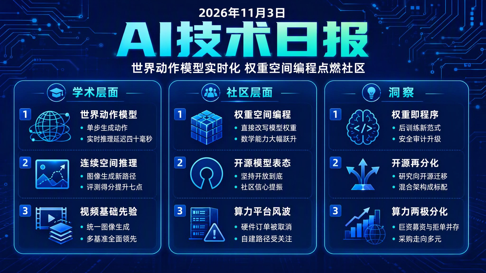

# 🌅 破晓 AI 情报早报 · 2026-11-03（周二）

> 数据来源：HuggingFace Daily Papers（2026-11-02 批次）· HackerNews · Reddit LocalLLaMA
> 生成时间：2026-11-03 07:00（北京时间）

---

## 📡 学术概览

> 本日 HuggingFace Daily Papers 2026-11-02 批次共 37 篇。本批次核心主题：世界动作模型（WAM）的实时化与泛化、连续空间潜在推理、视频基础模型先验的统一图像生成、具身智能的运行时与后训练管线。社区端今日最大事件是「权重空间编程」在 HackerNews 与 Reddit 双平台共振（HN 1533 分领跑全站）。

### Tier 1 · 核心突破

1. **FrameForge：用视频基础模型的先验做统一图像生成（FrameForge：Harnessing Priors of Video Foundation Models）**

   🔬 领域：视频生成 · 图像生成 · 视频基础模型 · 热度：HF Daily Papers（11-02 批次）

   - **一句话核心贡献**：发现条件-目标关系随生成任务变化、而视频模型天然编码多时间尺度变换，于是用「输入自适应的虚拟时间关系」建模条件图像生成——MoTE 动态选择时域 RoPE 专家、CoTR 经潜在中间态推理变换，在 DreamBench / COCO2017 / GEdit-Bench 上全方位超过对比方法。
   - **摘要精译**：
     统一条件图像生成要求单个模型在遵循文本指引产出目标图的同时，保留视觉输入的不同方面。预训练视频模型通过编码跨时间视觉变换提供了有前景的基础，但现有方法通常把条件与目标固定在特定时间位置；而实际上条件-目标关系随生成任务差异很大，视频模型又在不同时间尺度上自然编码视觉变换。这促使作者用「输入自适应的虚拟时间关系」来建模条件生成。
     论文提出的 FrameForge 捕获这种关系的两个互补方面：时域专家混合（MoTE）通过动态选择不同虚拟间隔的时域 RoPE 专家，刻画目标与条件之间的时间距离；时间推理链（CoTR）通过潜在中间状态建模条件如何被变换为目标，并用推理瓶颈注意力掩码强制信息沿这条通路传播。
     在 DreamBench、COCO2017 与 GEdit-Bench 上的实验表明，FrameForge 在主体驱动生成（subject-driven generation）、canny 转图像与图像编辑任务上均取得优于对比方法的性能。
   - **核心创新点**：
     1. 虚拟时间关系建模条件生成
     2. 时域专家混合动态选 RoPE
     3. 推理瓶颈掩码强制信息通路

   

   
💡 展开详情（方法论 + 实验）

   - **方法细节**：把「条件→目标」的变换建模为虚拟时间关系——MoTE 用多个不同虚拟间隔的时域 RoPE 专家，按输入动态选择以估计条件到目标的时间距离；CoTR 引入潜在中间状态，配合 reasoning-bottleneck attention mask 促使信息沿「条件→中间→目标」通路传播，二者互补覆盖变换的「距离」与「路径」两个维度。
   - **实验结果**：DreamBench（主体驱动生成）、COCO2017（canny 引导）、GEdit-Bench（图像编辑）三个基准上均为对比方法中最佳；摘要未给出具体量化增益，报告为 superior performance。
   - **局限性**：摘要未披露与单任务专用模型的差距、以及长尾编辑指令下的失败案例；具体提升幅度需读全文。
   - **链接**：https://arxiv.org/abs/2610.36545

   

2. **Wizard：Agent 框架实时操控任意世界（Wizard: Manipulate Any World in Real Time）**

   🔬 领域：视频生成 · 世界模型 · Agent 控制 · 热度：HF Daily Papers（11-02 批次）

   - **一句话核心贡献**：构建覆盖 750 个场景、178 个角色的多样化数据集，用骨架与几何信息作结构化中间表示 + 自适应掩码条件化视频生成模型，再配一个显式维护并更新游戏状态的 Agent 框架，实现跨新场景/角色/动作零样本、实时且机械保持一致的角色运动控制。
   - **摘要精译**：
     视频世界模型的进展已能生成日益逼真、可交互的虚拟环境，为玩家可自定义的游戏玩法打开新可能；Agent 框架则通过把显式游戏逻辑、可控世界表示与视觉生成解耦来进一步推进。但现有方法只支持简单游戏设定与预定义运动模式，对未见环境与角色泛化差，实时交互能力有限。
     论文提出 Wizard——一个 Agent 化游戏世界模型：跨新场景、角色、动作零样本泛化，同时支持对角色运动的实时精确控制。作者构建了覆盖 750 场景与 178 角色的数据集，纳入骨架与几何信息作为结构化表示；并把这些表示作为中间代理来条件化视频生成模型，配合自适应掩码机制改善条件信号与生成视频 rollout 的对齐。
     此外引入 Agent 框架显式维护与更新游戏状态，玩家可自由配置虚拟世界、对角色运动做细粒度控制，同时保持视觉质量与玩法一致性。结合 Agent 控制与基于结构化代理的生成，框架为「玩家驱动的游戏创作」解锁了实时、可泛化、机制一致的世界模拟新可能。
   - **核心创新点**：
     1. 骨架几何中间表示条件化生成
     2. 自适应掩码对齐条件与 rollout
     3. Agent 框架显式维护游戏状态

   

   
💡 展开详情（方法论 + 实验）

   - **方法细节**：数据侧构建 750 场景 × 178 角色数据集（含骨架与几何信息）；生成侧把这些结构化表示作为中间代理条件化视频生成，自适应掩码按条件信号与生成 rollout 的对齐程度动态调节；控制侧由 Agent 框架显式持有并更新游戏状态，支持玩家配置世界与细粒度操控角色运动。
   - **实验结果**：摘要报告在未见场景、角色与动作上可实现零样本实时控制，视觉质量与玩法一致性得以保持；具体量化指标（FVD/用户研究等）需见全文。
   - **局限性**：750 场景规模相对真实开放世界仍有限；「玩家自由配置世界」的上限（复杂交互、物理规则变更）未在摘要中边界化。
   - **链接**：https://arxiv.org/abs/2610.40339

   

3. **OSWAM：单步生成动作的世界动作模型（An Effective World Action Model with One-Step Action Generation）**

   🔬 领域：世界模型 · 自动驾驶 · 具身控制 · 热度：HF Daily Papers（11-02 批次）

   - **一句话核心贡献**：指出直接策略 WAM 需数十步去噪的根源是「随机噪声初始化缺少结构化动作先验」，于是构造想象 token（imagination tokens）为扩散过程提供物理先验与动作条件化表示，并加未来条件化的特权信息蒸馏——单步即可生成高质量动作，效果持平或更好，3 倍加速，RTX 5090 上低至 40ms。
   - **摘要精译**：
     直接策略的世界动作模型（WAM）证明了把动作生成与显式未来视觉预测解耦能提升自动驾驶与具身控制推理效率。但它们仍需要数十步去噪才能达到有竞争力的动作质量，延迟显著、阻碍实时部署。简单减少去噪步数会令非线性多步去噪轨迹坍缩为粗糙更新，严重损害动作质量。
     为在减少去噪步数的同时实现实时动作生成，论文提出 OSWAM——单步动作生成的世界动作模型。作者论证：正是随机噪声初始化中缺少结构化动作先验，才迫使直接策略 WAM 通过迭代去噪恢复连贯动作序列。因此用想象 token 初始化扩散过程，提供物理先验与动作条件化表示；再引入带未来条件化的特权信息蒸馏，增强未来感知的动作生成。
     结果 OSWAM 仅用一步扩散即可高效产出高质量动作。实验表明其在自动驾驶与具身控制上达到与需数十步的直接策略 WAM 和 Joint-WAM 相当甚至更好的效果，相对直接策略 WAM 基线获得约 3 倍加速，支持实时编译推理——NVIDIA RTX 5090 上延迟低至 40ms。
   - **核心创新点**：
     1. 想象 token 注入结构化动作先验
     2. 未来条件化特权信息蒸馏
     3. 单步去噪达数十步质量

   

   
💡 展开详情（方法论 + 实验）

   - **方法细节**：核心洞察是随机噪声初始化迫使直接策略 WAM 用迭代去噪补足「动作结构」；OSWAM 用想象 token（携带物理先验与动作条件化表征）初始化扩散轨迹，再以未来条件化做特权信息蒸馏（privileged information distillation with future conditioning）增强未来感知生成，从而把数十步压缩到 1 步。
   - **实验结果**：自动驾驶与具身控制两个域均达「相当或更好」于数十步的 direct-policy WAM 与 Joint-WAM；相对 direct-policy 基线 ~3× 加速；RTX 5090 上编译推理延迟低至 40ms，满足实时部署。
   - **局限性**：单步设置下极端长程动作质量与跨域泛化（新车/新传感器）边界未在摘要展开；40ms 依赖 RTX 5090 级硬件。
   - **链接**：https://arxiv.org/abs/2610.35850

   

4. **LARC：连续空间潜在推理统一多模态模型（Latent Reasoning in Continuous Space）**

   🔬 领域：多模态 · 推理 · 图像生成 · 热度：HF Daily Papers（11-02 批次）

   - **一句话核心贡献**：指出现有推理增强 UMM 失败的根源是「离散 token 空间推理 vs 连续图像空间生成」的模态错配，提出在连续隐藏状态上推理的 LARC（课程 SFT + 信息增益 RL 两阶段），GenEval 上比 BAGEL 高 7 个百分点，且展示出清晰的 test-time scaling。
   - **摘要精译**：
     统一多模态模型（UMM）在多样多模态理解与生成任务上成绩显著，但仍难有效利用基于语言的思维链推理来做图像生成；结果现有推理增强 UMM 往往无法继承大语言模型中观察到的测试时扩展与细粒度可控性。作者把这归因于根本性的模态错配：推理在离散 token 空间进行，而图像生成工作在连续空间。
     为弥合这一鸿沟，论文提出连续空间潜在推理框架 LARC，通过在连续隐藏状态上推理来缓解 token 级瓶颈。训练框架分两阶段：先是课程式监督微调（curriculum SFT），把 token 级推理逐步转化为潜在推理；随后是信息增益强化学习（information-gain RL），在无真值监督下让潜在推理自我演化。
     在多个文生图基准上的实验显示，LARC 一致地提升生成质量、指令遵循与组合保真度。尤其亮眼的是：LARC 在 GenEval 上以比 BAGEL 高 7 个百分点的增益达到 SOTA，并在并行与串行两种测试时扩展策略下都优于基于 token 的生成，展现出明确的测试时扩展行为。
   - **核心创新点**：
     1. 连续隐藏状态推理解模态错配
     2. 课程 SFT 渐进潜在化推理
     3. 信息增益 RL 无监督自演化

   

   
💡 展开详情（方法论 + 实验）

   - **方法细节**：两阶段训练——(i) curriculum SFT 逐步把 token 级推理转换为 latent reasoning；(ii) information-gain RL 无真值条件下让潜在推理自我进化。目标是用连续空间推理替代离散 token 推理，绕开 token 瓶颈，直接对齐图像生成的连续操作空间。
   - **实验结果**：多个文生图基准上一致提升生成质量、prompt following 与组合保真度；GenEval 上较 BAGEL 提升 7%p 达 SOTA；并行/串行两种 test-time scaling 策略下均超越 token 级生成基线，显示清晰 scaling 行为。
   - **局限性**：评估以文生图为主，理解类任务的迁移效果、以及信息增益 RL 在超长推理链上的稳定性未在摘要说明。
   - **链接**：https://arxiv.org/abs/2610.42149

   

5. **REA：路由式具身 Agent 运行时（Routed Embodied Agent Runtime for Asynchronous Brain-Cerebellum Control）**

   🔬 领域：具身智能 · Agent 运行时 · VLA · 热度：HF Daily Papers（11-02 批次）

   - **一句话核心贡献**：提出「路由式具身 Agent」运行时 REA，用路由记忆 + 边界触发判定门 + 共享预算升级阶梯，让深思型 System-2、路由器 System-1 与反应型 System-0 策略在一条铁律下协作（运行的策略绝不等待大脑），LIBERO-Pro 上 95.9% 成功率超单 Agent 基线，控制步数与时间分别降 25% / 17%。
   - **摘要精译**：
     基础模型在高层级推理上日益可靠，但作为细粒度控制器仍太慢太贵；快速策略（VLA、全身控制器等）反射效率高却难泛化。把深思型「大脑」（基础模型）与反应型「小脑」（快速策略）配对看似自然，却有两个障碍：方法构建与打分栈不兼容、异步协调困难——例如 Agent 循环中调用 VLA 会拖慢快速执行，VLA 出错时回调 Agent 则易反复触发兜底或完全漏掉静默失败。
     为此论文提出 REA，一个统一运行时：深思型 System 2、具身路由器 System 1 与反应型 System 0 策略在单一铁律下协作——正在运行的策略永远不等待大脑。REA 不在每次失败时都查询大脑，而是预先用路由记忆存储每个策略实测成功表现，用边界触发判定门在策略执行时咨询大脑，用共享预算升级阶梯做有界恢复。
     在 RoboTwin 2.0 的 100 个 episode 研究中，REA 用 VLA 策略达 84% 成功率、VLA+代码达 86%，强于最强单 VLA 基线 MEDex（80%）；在 LIBERO-Pro 的 60 个任务、3000 个测试 episode 上，REA 达 95.9% 成功率，胜过其策略池内最佳单 Agent 基线（94.7%），同时控制步数降 25%、控制时间降 17%。REA 还迁移到 BEHAVIOR-1K 与真实宇树 G1 人形机器人，均取得对比方法中最高观测成功率。
   - **核心创新点**：
     1. 路由记忆预存策略实测成功率
     2. 边界触发判定门按需咨询大脑
     3. 共享预算升级阶梯有界恢复

   

   
💡 展开详情（方法论 + 实验）

   - **方法细节**：三级智能体（System 2 深思 / System 1 路由 / System 0 反射）在同一运行时协作，核心铁律即「运行中策略不等待大脑」。组件：route memory（预先记录各策略实测成功率，避免失败即问大脑）、boundary-triggered judge gate（策略执行到边界时才咨询大脑）、shared-budget escalation ladder（有界恢复预算防止无限兜底）。
   - **实验结果**：LIBERO-Pro 60 任务 3000 episodes：95.9% 成功率（策略池内最佳单 Agent 94.7%），控制步数 -25%、控制时间 -17%；RoboTwin 2.0 100 episodes：VLA 84%、VLA+code 86%（对照最强单 VLA 基线 MEDex 80%）；迁移 BEHAVIOR-1K 与真实宇树 G1 人形机器人，成功率最高。
   - **局限性**：成效依赖策略池本身的多样性（若池内策略都弱，路由收益有限）；「铁律」在策略自身死锁或大脑长时间不可用场景下的退化行为未在摘要边界化。
   - **链接**：https://arxiv.org/abs/2610.42053

   

6. **CaPtain：Code-as-Policy 机器人 Agent 的后训练管线（A Pipeline for Post-Training Code-as-Policy Robot Agents）**

   🔬 领域：具身智能 · 后训练 · 代码即策略 · 热度：HF Daily Papers（11-02 批次）

   - **一句话核心贡献**：开源了一条把小型开放 VLM 训练成可用 CaP agent 的完整后训练管线：用 GPT-6 Astra 生成的合成轨迹做 SFT 对齐接口、再用带「物理评论器」的多轮 RL 掌握操控——Qwen3.5-4B 从零样本 0% 提升到 LIBERO 73.8%、LIBERO-PRO 78.5%，超越多个前沿模型 agent 且全部开源。
   - **摘要精译**：
     在编码、Web 与工具使用任务上，语言模型 Agent 已常规采用同一配方：先用监督微调（SFT）学习接口，再用多轮强化学习（RL）精通它。Code-as-policy（CaP）把机器人操控也归入同一形式——策略针对机器人 API 写代码并读回结果，因此同一配方应当适用。但现有 CaP agent 绕过训练：要么提示闭源前沿模型，要么把操控委托给预训练 VLA 与高层技能；小型开放 VLM 则直接失败。
     论文提出 CaPtain——把小型开放 VLM 变成合格 CaP agent 的开放后训练管线，测试时无 VLA、无前沿模型、无特权状态。CaPtain 在 CaPtain-Harness 内训练与部署策略，该 Harness 在仿真与真实硬件上暴露低级感知、几何与受保护运动原语。作者先用 GPT-6 Astra 生成的合成轨迹做 SFT 对齐基础模型，再施多轮 RL。
     多轮 RL 必须把单个 episode 末尾的唯一结果，回授给数十个 Agent 请求（其物理效果往往数轮后才显现）。为此引入物理评论器：读取策略从未见过的仿真器特权状态，按每个请求对预测成功概率的改变来计分。从 Qwen3.5-4B（零样本 0%）出发，CaPtain-4B 经 SFT 后 LIBERO 留存集达 55.4%，RL 后达 73.8%；LIBERO-PRO 上达 78.5%，超过若干前沿模型 Agent；RL 增益在三个扰动套件上持续（+17.6 至 +21.2 点）。无目标域训练时在 SimplerEnv WidowX 达 83.3%，在 CaP-Bench 上超过前沿模型，仿真训练后可直接部署到真实机器人。代码、数据与权重全部开源。
   - **核心创新点**：
     1. 物理评论器按成功概率变化计分
     2. 合成轨迹 SFT + 多轮 RL 配方
     3. 无 VLA/特权状态的 4B 开源 CaP

   

   
💡 展开详情（方法论 + 实验）

   - **方法细节**：CaPtain-Harness 在仿真与真机暴露低级感知、几何与 guarded-motion 原语，策略以代码形式调用这些 API。训练两段式：GPT-6 Astra 合成轨迹 SFT（学习接口）→ 多轮 RL（掌握操控）。RL 的信用分配难题用 physical critic 解决——它读取特权仿真状态、计算每个请求对成功概率的边际贡献并据此分配合法化回报。
   - **实验结果**：Qwen3.5-4B 零样本 0% → SFT 后 55.4%（LIBERO 留存）→ RL 后 73.8%；LIBERO-PRO 78.5% 超多个前沿模型 agent；三个扰动套件 +17.6~+21.2 点；无目标域训练下 SimplerEnv WidowX 83.3%；CaP-Bench 超前沿模型；仿真训练后真机可用。全部代码/数据/权重开源。
   - **局限性**：规模止步 4B，更大基座的收益未验证；依赖 GPT-6 Astra 合成数据，若合成轨迹分布与真机需求错配，SFT 质量可能受影响。
   - **链接**：https://arxiv.org/abs/2610.40799

   

### Tier 2 · 工程改进与垂直应用

1. **WorldBridge：视频与动作桥接，提升世界动作模型任务泛化**

   🔬 领域：具身智能 · 世界模型 · 视频泛化 · 热度：HF Daily Papers（11-02 批次）

   - **一句话核心贡献**：从 RoboTwin 2.0 上 25.07% → 55.90% → 70.70% 的渐进实验出发，证明「更广的视频覆盖 + 稀疏动作标注」就能撬动任务迁移，据此提出视频/动作双专家 + 联合流匹配 + 两尺度视觉记忆 + 动作强制的 WorldBridge，在多个操控基准达 SOTA（RoboTwin 96.23%）。
   - **摘要精译**：研究通过改变初始训练集之外任务的视频/动作监督量，考察二者对任务迁移的贡献：只用分布内视频-动作监督时 OOD 任务成功率 25.07%；补上这些任务的无标签视频后升至 55.90%；再每任务加一条动作标注演示则达 70.70%——表明更广的视频覆盖能借力已有逆动力学能力实现迁移，稀疏动作监督进一步强化该能力。WorldBridge 据此分离视频与动作专家、以结构化注意力连接，用联合流匹配训练，并配两时间尺度视觉记忆、动作强制与统一数据管线（标准化过滤异构轨迹与手部标注），在 RoboTwin 2.0 全量数据上达 96.23%、clean-to-random 80.9%。
   - **核心创新点**：
     1. 视频/动作专家分离 + 联合流匹配
     2. 量化视频监督对迁移的边际贡献
     3. 两时间尺度视觉记忆 + 动作强制
   - 🔗 [论文链接](https://arxiv.org/abs/2610.40748)

2. **HiFOR：动作引导世界检索的分层前瞻 VLA**

   🔬 领域：具身智能 · VLA · 世界建模 · 热度：HF Daily Papers（11-02 批次）

   - **一句话核心贡献**：针对「短期动力学与长期任务目标分开建模、且未来预测未经动作相关性筛选直接注入策略」两大缺陷，提出分层依赖掩码（HDM）的层次前瞻预测 + 结构化潜在世界建模 + 动作引导因子化检索，在 2 个仿真基准与 6 个真实操控任务上验证有效。
   - **摘要精译**：VLA 模型在机器人操控上已展现潜力，近期进展进一步纳入未来预测以增强环境动力学与任务进度理解。但现有方法常分别建模短期动力学与长期任务目标，且把预测未来直接注入策略、未充分考虑其与当前动作需求的相关性。HiFOR 提出：(1) 分层前瞻预测——用分层依赖掩码联合预测短期状态演化、语义里程碑与最终目标状态，建立跨时间尺度依赖；(2) 结构感知潜在世界建模——沿时间、视角与空间维度组织未来潜在表征以便细粒度检索；(3) 动作引导因子化世界检索——在去噪过程中基于演化中的动作表征自适应检索相关性未来信息。2 个仿真基准与 6 个真实操控任务实验证明有效性。
   - **核心创新点**：
     1. 分层依赖掩码打通时间尺度
     2. 潜在世界按视角/空间维度建模
     3. 去噪中动作引导细粒度检索
   - 🔗 [论文链接](https://arxiv.org/abs/2610.40373)

3. **Apriel Voice 27B Preview：开源语音-推理-工具一体化模型**

   🔬 领域：语音智能 · 多模态 · 开源模型 · 热度：HF Daily Papers（11-02 批次）

   - **一句话核心贡献**：在 Gemma 4 26B-A4B 后训练基座上构建的开放语音语言模型，共享推理主干、直接处理语音并生成回复与工具调用，两阶段训练（语音接口建立 + 投影器与主干联合适配），支持文本/图像输入，无需独立对话模型。
   - **摘要精译**：合格语音助手不能只识别词汇，还必须理解请求、协调上下文推理、维持对话并借助工具行动。Apriel Voice 27B Preview 是一个开放语音语言模型，把这些能力统一在共享推理主干中，同时保留文本与图像输入模态。它基于后训练的 Gemma 4 26B-A4B 检查点，直接处理语音并生成回复与工具调用，无需独立对话模型。训练采用两阶段流程：第一阶段建立语音接口；第二阶段通过监督微调、文本回放与 source-dependent 交叉熵及前向 KL 散度监督联合适配投影器与主干；自动构建的语音条件对话用于训练。预览版定位是向社区开放早期能力验证。
   - **核心创新点**：
     1. 共享推理主干统合语音/推理/工具
     2. 两阶段语音适配（接口→联合微调）
     3. 无独立对话模型的端到端语音生成
   - 🔗 [论文链接](https://arxiv.org/abs/2610.40738)

4. **Metis-1.6 Technical Report：单个研究者从零训练的两个小模型**

   🔬 领域：基础模型 · 数据效率 · 架构实验 · 热度：HF Daily Papers（11-02 批次）

   - **一句话核心贡献**：研究者 Giulianno Vollmer 从零训练 Praxis（2.94B，活跃 0.46B）与 Logos（10.23B，活跃 1.18B）两个混合 Mamba-2 + attention MoE 模型（每 token 跑两遍堆栈），各训 1.02T token；Logos 在 40 个后训练基准平均 52.93 分，逼近 Qwen3-4B，但训练数据量约为中位数对手的十二分之一。
   - **摘要精译**：Metis 是一次押注：更好的数据、更好的训练方法与新架构，能买到更大参数量买不到的东西，且成本只是零头。Metis-1.6 是其最新一步——单研究者从零训练两个模型：Praxis（2.94B 参数，每 pass 活跃 0.46B）与 Logos（10.23B 参数，活跃 1.18B），二者都跑混合 Mamba-2 与 attention MoE 堆栈，每个 token 跑两遍（每个 token 获得第二次审视）。各自训 1.02T token：804.76B 预训练 + 18B 上下文扩展至 131,072 token + 200B 监督微调。
     Metis-1.6 本无意挑战前沿模型，在 40 个后训练基准上大多也确未挑战：Logos 平均 52.93，在 17 个模型的对比组里排第七，与 Qwen3-4B 差在 1 分内；但它是用约为对比组中位数训练数据十二分之一的量做到的。作为「小成本数据效率」样本，它展示了单人研究者在架构（Mamba-2 + MoE 混合、双遍堆栈）与数据配比（预训练/扩展/微调 ≈ 79%/2%/20%）上的可复现空间。
   - **核心创新点**：
     1. Mamba-2 + attention MoE 双遍堆栈
     2. 1/12 训练数据逼近 Qwen3-4B
     3. 单人从零训练全流程开源报告
   - 🔗 [论文链接](https://arxiv.org/abs/2610.37903)

## 🔥 社区速递

### 热点事件

1. **权重空间编程走红：Astra 能读写 Qwen 权重，MATH-500 从 7.9% 提到 48.1%**

   🔥 热度信号：HackerNews Score 1533（今日 TOP1）· Reddit LocalLLaMA 双热帖 · 来源：rikiyat.github.io / Reddit

   - **一句话核心**：社区博客展示 LLM 原生读写神经网络权重（Weight-Space Programming），并晒出 GPT-6 Astra 直接编辑 Qwen 权重后 MATH-500 从 7.9% 跃升至 48.1% 的实测——「模型权重成为可编程接口」的叙事冲上 HN 榜首，Reddit 同步炸开。  
   - **核心共识**：
     1. 权重即程序：把权重当作可读写、可编辑的「代码」，无需重训即可注入或修复能力，是比 LoRA 更直接的后训练新范式
     2. 7.9% → 48.1% 的跳跃说明编辑空间真实存在且收益巨大，但社区同时追问其通用性与可靠性边界（对其它任务/模型是否同样有效）
     3. 与「Reverse-Engineering 模型内部」的既有探索（activation/steering）一脉相承，被视为可解释性工程化的下一步
   - **主要争议**：Astra 的权重编辑是「泛化可复现的方法」还是「针对特定评测的过拟合特例」？权重空间编程的安全影响——能改权重就能植入后门，是否成为新的投毒面？
   - **影响评估**：直接冲击「能力提升必须走重训/SFT/RL」的成本叙事：若权重编辑成熟，微调服务、适配层与对齐流程都可能被重写；同时为推理模型供应链带来新的安全审计需求（权重溯源与完整性校验）。
   - 🔗 [HN 原帖](https://rikiyat.github.io/blog/weight-space-programming/)
   - 🔗 [Reddit 讨论 · Sparks of Weight-Space Programming](https://www.reddit.com/r/LocalLLaMA/comments/1xm6jow/sparks_of_weightspace_programming_llms_can/)
   - 🔗 [Reddit 讨论 · GPT-6 Astra Edits Qwen Weights](https://www.reddit.com/r/LocalLLaMA/comments/1xma0tw/gpt6_astra_edits_qwen_weights_math500_79_to_481/)

2. **Qwen 官方声明：开源坚持到底**

   🔥 热度信号：Reddit LocalLLaMA 热帖 #2 · 来源：Reddit（官方声明帖）

   - **一句话核心**：Qwen 团队发布官方声明——Qwen 模型将坚持开源到底；在 Model-as-a-Service 与闭源转向不断的 2026 年底，这成为社区开源信心的强心针。  
   - **核心共识**：
     1. 开源大模型阵营仍需要「旗手」：在多家头部厂商收紧开放策略时，Qwen 的明确表态直接锚定了开源生态的供给预期
     2. 「开源到底」意味着 3.x/4.x 系新模型仍会走权重完全开放路线，社区可继续基于此做量化、微调与本地部署规划
     3. 与当日另一热点（Anthropic 削减逆向工程工具）形成对照——开源与封闭的信任差继续拉大
   - **主要争议**：「坚持开源」是否涵盖训练数据与全部配套工具链，还是仅指模型权重？相对「开源到最后」的长期商业可持续性如何保证？
   - **影响评估**：对本地推理与自托管用户是确定性利好：新 Qwen 模型将继续进入 GGUF/量化生态；对依赖闭源 API 的团队是又一次「多供应商 + 开源回退」组合的论证。
   - 🔗 [Reddit 原帖](https://www.reddit.com/r/LocalLLaMA/comments/1xm28e6/official_statement_qwen_models_will_stick_to_open/)

3. **Amazon 被曝取消 GPU 订单，甚至关闭购买算力硬件用户的账户；Tim Sweeney 亦中招**

   🔥 热度信号：Reddit LocalLLaMA 热帖 #3 · 来源：Reddit（社区曝光帖）

   - **一句话核心**：社区爆料 Amazon 正在取消用户的 GPU 订单、在个别情况下直接关闭为购买算力硬件而注册的账户，Epic 的 Tim Sweeney 也被卷入——「买 GPU 被清号」的指控在 LocalLLaMA 区迅速发酵。  
   - **核心共识**：
     1. 云厂商对「购买硬件自行部署」的态度在收紧，账面上是风控行为，社区普遍解读为平台不想让客户绕开自家云服务
     2. 个人与中小团队自建 GPU 集群的路径面临「掐单 + 封号」双重不确定性，硬件采购风险显著上升
     3. 与 GPU 供给整体趋紧的大背景叠加，算力「去平台化」的成本与摩擦被重新评估
   - **主要争议**：这是 Amazon 针对「转售/矿工式」异常订单的风控误伤，还是刻意限制客户自购硬件的策略？被关闭的账户是否涉及滥用，还是纯正常的算力采购？
   - **影响评估**：对依赖云厂商采购 GPU 的团队是直接警示：采购渠道需要多元化，订单取消/账户风险应纳入算力规划；对「本地 + 云」混合架构的自托管叙事又是一次佐证。
   - 🔗 [Reddit 原帖](https://www.reddit.com/r/LocalLLaMA/comments/1xm8o8g/amazon_is_allegedly_canceling_gpu_orders_and_in/)

4. **Anthropic 再度收窄逆向工程工具：又一条自托管的理由**

   🔥 热度信号：Reddit LocalLLaMA 热帖 #8 · 来源：Reddit

   - **一句话核心**：社区反映 Anthropic 再次削减面向模型内部机制的逆向工程相关工具/能力出口，被用户总结为「又一条必须自托管的理由」——闭源模型的可观测性与可控性继续收缩。  
   - **核心共识**：
     1. 闭源边界持续收窄：从训练竞品封禁（11-01 热帖）到逆向工具削减，Anthropic 对「模型内部」的开放度一路下调
     2. 对做可解释性、安全审计、红队的研究者，闭源模型意味着「黑箱加厚」，方法验证必须迁移到开源模型上完成
     3. 自托管的理由清单继续加长：数据控制权之外，可观测性/可逆向性成为新权重
   - **主要争议**：这是合规与滥用防护的合理收紧，还是对研究社区的实际伤害？削减工具是否真的能阻止滥用，还是仅增加研究成本？
   - **影响评估**：可解释性与对齐研究的「开源化」加速——研究者会把更多工作流固定到 Llama/Qwen 等开放权重模型上；闭源 API 在研究预算中的比重可能进一步下降。
   - 🔗 [Reddit 原帖](https://www.reddit.com/r/LocalLLaMA/comments/1xm33gr/yet_another_reason_to_self_host_anthropic_has/)

### 其他值得关注

- **Ubuntu 近三周仍未发布 Linux 0day RCE 补丁（HN 226，今日 TOP6）**：freenode.net 报道 Ubuntu LTS 内核对 CVE-2026-98432 长期未修复，Linux 0day 远程代码执行漏洞悬而未决，服务器运维侧值得关注。
- **ISTA GSQ-RCO vs Unsloth 的量化基准之争（Reddit 多条热帖）**：763B 参数的 1-bit DeepSeek-V4.1 Coder（GSQ-RCO）发布后，社区围绕 512K 上下文 GGUF 基准、LiveCodeBench 成绩不一致展开论战（#6/#12/#13/#15），量化质量评测标准成为焦点。
- **新的稀疏注意力方法欲破超长上下文（Reddit 热帖 #9）**：社区转发热门稀疏注意力论文，直指 ultra-long context 的注意力开销问题。
- **Show HN：Subvocal——无声对话电脑（HN 456，今日 TOP3）**：语音接口新形态，麦克风拾取无声说话信号与电脑交互的硬件/软件组合。
- **GPT-6 Astra 的另一战场：Agentic backdoors（HN 77）**：arXiv 2610.37741 揭示预训练投毒可实现 Agentic 后门，与「权重可编辑」热点形成安全侧镜像。
- **LongCat-2.5：面向 Agent 任务的原生多模态（HN 70）**：longcat.ai 发布 2.5 版本，原生多模态能力面向 agentic 任务设计。
- **LocalLLaMA 社区两则**：「本地量化 vs Claude 实测 9 个真实 bug」（#10）与「还有必要微调本地模型吗」（#17）继续探讨本地生态的能力与性价比边界。

## 💰 商业动态

1. **Oracle 发行 200 亿美元新股与债券，为 AI 基础设施建设融资**

   现象：Oracle 向 SEC 递交文件，拟通过发行新股加债券募资 200 亿美元，专项用于 AI buildout（数据中心与算力基础设施）——与 AI 军备竞赛的资本开支周期直接相关。
   解读：头部云厂商仍在用股权与债市「加杠杆」抢算力资源：先锁定 GPU 与数据中心，再靠未来 AI 收入消化负债。200 亿美元量级显示 AI 基础设施投入仍未减速，供给侧资本开支继续高企。

2. **Amazon 取消 GPU 订单事件背后的算力供需信号**

   现象：社区曝光 Amazon 取消 GPU 订单并关闭部分账户（见社区速递 #3），叠加当日 Reddit 区 GPU 相关讨论热度，显示算力硬件流通环节的摩擦在上升。
   解读：若消息属实，说明云厂商在「引导客户使用自有云算力」与「硬件供给紧张」之间采取更积极的风控姿态；对 AI 初创的采购与部署规划构成新的不确定变量。

3. **BYD 上月电动车销量 30 万+，单月超美国整个季度（HN 180）**

   现象：electrek 报道 BYD 上月电动车销量突破 30 万辆，单月数字超过美国市场一个季度的总销量。
   解读：虽然非直接 AI 新闻，但电动车的电池/芯片供应链与 AI 算力硬件存在上游重叠；持续的超额产能也提示供应链产能外溢到消费硬件的可能性。列入商业观察侧线。

4. **Momentic（YC W24）：用 Agent 替你「用 App 找 bug」的测试新物种（Launch HN）**

   现象：Momentic 以「Agents that catch bugs by using your app」登陆 Launch HN——AI Agent 直接操作应用做端到端测试，把「人肉点检」自动化。
   解读：Agent 化的 QA 工具是 2026 下半年测试基础设施的明确方向：把「让模型用你的产品」变成可落地的商业服务，是 Agent 应用层商业化的重要样本。

## 🏢 职场动态

1. **逆向工程工具收缩 → 研究型岗位的工具链迁移（依据社区 #4）**：Anthropic 再度收窄模型逆向工具后，可解释性与安全研究的方法论重心将持续从闭源模型迁移到开放权重模型——相关岗位的技能树会进一步向开源生态倾斜。

2. **GPU 采购不确定性 → 算力规划岗位的新变量（依据社区 #3）**：Amazon 取消 GPU 订单风波提醒基础设施团队：硬件采购渠道多元化与「被平台风控」的应急预案，应纳入 AI 算力规划与供应链岗位的日常清单。

3. **Agent 测试工具升温（依据 Launch HN）**：Momentic 类 Agent 化 QA 工具的涌现，预示 QA/测试工程岗位将经历「人肉回归 → Agent 编排 + 人工审阅」的职责重构，测试工程与 LLM 应用开发的技能边界加速融合。

## 📊 今日总结

1. **模型权重变成「可读写程序」：后训练的范式裂缝出现**

   - **现象**：HN 榜首（1533 分）博客展示 LLM 原生读写神经网络权重，并晒出 GPT-6 Astra 编辑 Qwen 权重后 MATH-500 从 7.9% 提升到 48.1% 的实测；该话题同时占据 Reddit LocalLLaMA 两条热帖，与「Sparks of Weight-Space Programming」的学术讨论在同一天共振。
   - **逻辑**：如果能力可以「直接编辑权重」而非「重训/微调」，意味着后训练的边际成本叙事被挑战——编辑是查找与改写，训练是数据与算力的重演；编辑器能力（Astra）越强，这条路越现实。这也天然带来双刃：能改权重就能注入后门，安全审计维度随之升级。
   - **预测**：权重溯源、完整性校验与会签会成为模型供应链标配；「权重编辑」类工具与创业机会开始出现，第一波将落在评测修复、能力注入与模型审计三个方向，而 SFT/RL 的价值会向「权重编辑够不着」的深层次能力迁移。

2. **开源「旗手」与闭源「收窄」同日同屏：信任分水岭继续加深**

   - **现象**：Qwen 官方声明模型将坚持开源到底（Reddit 热帖 #2），同一天 Anthropic 被曝再度削减逆向工程工具（#8）——「开放到最后」与「边界继续收紧」两种信号在同一社区首页并置。
   - **逻辑**：开源模型的竞争力（Qwen 3.x/4.x 系列生态、本地量化）已经强到足以让厂商把「开源」当作战略承诺来营销；而闭源厂商的「内部机制开放度」持续下降，本质是竞争与合规压力下对模型核心资产的控制欲增强。两种策略都是对模型能力商品化的不同防守方式。
   - **预测**：可解释研究、安全审计与对齐方法论将加速「开源化」——研究者把工作流锚定在开放权重模型上；开源与闭源之间的「能力透明差」和服务「锁定差」会在采购决策中继续放大，混合架构（开源兜底 + 闭源增强）成为团队标配。

3. **算力军备的两极分化：千亿募资 vs 订单被砍**

   - **现象**：Oracle 拟发行 200 亿美元股票与债券专项融资 AI 基础设施建设（HN，CNBC），而同日社区曝光 Amazon 取消 GPU 订单、关闭部分硬件采购账户甚至波及 Tim Sweeney——头部云厂商「疯狂扩产」与「冷脸拒单」并存。
   - **逻辑**：头部云厂商的军备竞赛没有降温，Oracle 用债市与股权「加杠杆」锁算力；与此同时，平台对「客户自购硬件、绕开自家云」的容忍度下降，风控与商业策略交织。资金流向头部、硬件流向被管控——算力再分配的权力进一步向云厂商集中。
   - **预测**：算力采购的「平台依赖风险」会被更多公司计入成本模型，自托管、多云并行与硬件采购多元化的需求上升；GPU 流通环节的摩擦可能催生新的撮合与保险类服务，算力供应链的中介化、金融化趋势会加速。
