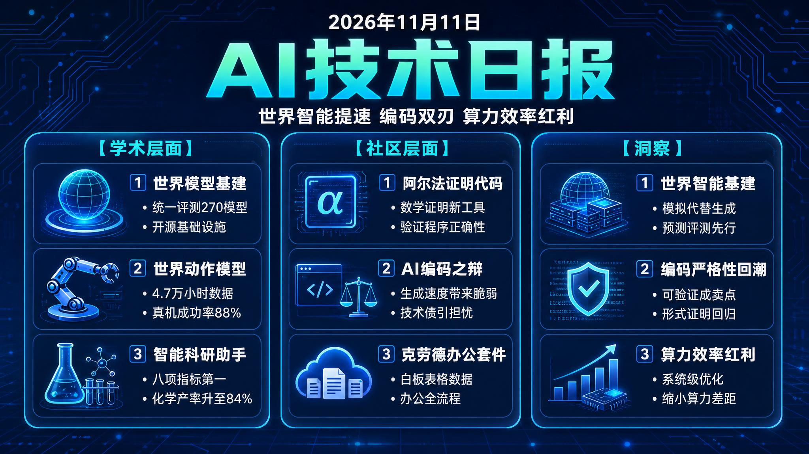

# 🌅 破晓 AI 早报 · 2026-11-11（周三）

> 数据来源：HuggingFace Daily Papers（2026-11-10 批次，36 篇）· HackerNews TOP 20 · Reddit LocalLLaMA（今日 0 条，跳过）· profile_demo.yaml
> 说明：HF 当日批次（UTC 22:00 发布）尚未上线，学术板块基于最近发布批次（2026-11-10）整理；Reddit 数据源今日返回 0 条，社区部分以 HN 为主。

---

## 📡 学术概览

### Tier 1 · 范式级创新

1. **WorldFoundry：面向"世界智能"的统一开源基础设施**

   🔬 领域：世界模型 · 视频生成 · 评测基础设施 · 热度：HF Daily Papers 2026-11-10 批次

   - **一句话核心贡献**：给出"生成式世界模型"的形式化定义（预测性动力系统），并发布横跨视频/3D/4D/具身动作/交互世界的统一开源推理与评测基础设施——目录收录 270 个模型条目、74 项基准与 62 项指标，把世界模型研究从"画得逼真"推向"可测量、可复现的世界智能"。
   - **摘要精译**：
     视觉生成模型越来越模糊"合成观测"与"模拟环境"之间的界限，但仅有视觉合理性并不构成成功的世界建模——看似可信的输出可能缺乏持久状态、物理动力学，或对交互缺乏因果一致的响应。为此作者先把"生成式世界模型"定义为一种预测性动力系统：维护持久的、历史条件化的环境表示，响应动作或干预而更新该表示，并生成反映观测与反事实干预结果的时序连贯轨迹。
     从这个定义出发，论文推导出涵盖感知接地、持久状态建模、可控变换、动力学感知预测、闭环交互的五层次智能导向框架，并实现 WorldFoundry 开源基础设施：统一模型与基准发现、运行时与资产准备、执行编排、工件管理与交互可视化，由模态专用适配器保留各系统的原生输入、执行语义、输出表示与评测协议；显式 manifest、持久化工件契约与证据感知记分卡把"执行就绪"与"评测主张"分离，使每条主张可追溯到支撑工件。
     目录现含 270 个模型条目、74 项基准与 62 项注册指标条目，就绪度与执行证据分开记录；WorldFoundry 由此支持跨异构系统复现比较持久、可控的动力学，推动该领域从感知级合成走向可测量的世界智能。
   - **核心创新点**：
     1. 形式化定义生成式世界模型
     2. 五层次智能导向评估框架
     3. 270 模型/74 基准统一基础设施

   

   
💡 展开详情（方法论 + 实验）

   - **方法细节**：以"预测性动力系统"作为世界模型的形式化定义，衍生五层框架（感知接地、持久状态建模、可控变换、动力学感知预测、闭环交互）；WorldFoundry 以 manifest + 工件契约 + 证据感知记分卡为核心，模态适配器保证跨视频/3D/4D/具身/交互系统的原生协议兼容。
   - **实验结果**：目录收录 270 个模型条目、74 项基准、62 项注册指标条目；readiness（执行就绪度）与 execution evidence（执行证据）分开记录，支持跨系统可复现对比（论文未设置单一总成绩数字，以目录规模与就绪度-证据分离机制作为基础设施贡献的衡量）。
   - **局限性**：基础设施侧重推理与评测编排，各系统模型的智能上限不在其能力范围内；跨模态评测协议尚未标准化到可直接跨系统横向比较的程度。
   - **链接**：https://arxiv.org/abs/2611.10771

   

2. **SWAM：跨模态对齐把世界动作模型推向真机**

   🔬 领域：视频生成 · 世界动作模型 · 机器人 · 热度：HF Daily Papers 2026-11-10 批次

   - **一句话核心贡献**：系统研究"动作学习如何破坏语言-视频对齐"并给出数据与监督设计原则——在约 47,000 小时混合视频数据上联合优化语言-视频-动作监督，仅用 RoboTwin Clean 演示后训练即在 Easy/Hard 条件分别达到 88.10%/61.56% 成功率，真实世界三任务成功率 40.00%（最强基线仅 23.33%）。
   - **摘要精译**：
     世界动作模型（WAM）以语言为条件联合预测视频与动作。现有研究主要聚焦架构与训练机制，把视频预训练获得的语言-视频对齐视为既定基础——但引入动作学习可能损害这种对齐，而关于数据与监督设计缺乏系统化指导。
     为填补这一空白，作者整理约 47,000 小时的数据池（通用视频、第一人称视频、UMI 演示与机器人演示），系统对比语言-视频监督、语言-视频-动作监督及两者联合对 WAM 性能的影响，考察语言标注质量如何影响预训练的语言-视频能力，以及 UMI 与机器人演示的动作监督如何扩展到语言-视频-动作建模，并在固定训练预算下研究联合训练配方与模型架构。
     实验表明：混合第一人称视频与 UMI 演示能改善控制泛化，架构决定这些经验被利用的效率，选定配置下扩大预训练带来进一步收益；最终配方仅用 RoboTwin Clean 演示后训练，Easy（Clean-to-Clean）与 Hard（Clean-to-Random）条件成功率分别为 88.10% 与 61.56%，真实世界三任务平均成功率 40.00%（最强基线 23.33%），数据、训练代码与模型权重全部开源。
   - **核心创新点**：
     1. 4.7 万小时混合数据池
     2. 动作学习对齐影响系统分析
     3. 真机成功率较基线近翻倍

   

   
💡 展开详情（方法论 + 实验）

   - **方法细节**：数据池含通用视频、第一人称视频、UMI 演示、机器人演示约 47K 小时；在固定预算下横向对比两种监督形式与联合使用，研究架构（混合专家/全注意力等）与预训练规模的交互；后训练阶段仅采用 RoboTwin Clean 演示数据，评测覆盖 Clean-to-Clean 与 Clean-to-Random 泛化。
   - **实验结果**：Easy/Hard 成功率 88.10%/61.56%；真实世界三任务成功率 40.00% vs 最强基线 23.33%；混合第一人称+UMI 数据提升控制泛化；数据、代码、权重开源。
   - **局限性**：真实世界评测仅 3 个任务，泛化结论的统计效力有限；数据池以英语场景为主，跨语言、跨机器人形态的可迁移性尚未验证。
   - **链接**：https://arxiv.org/abs/2611.12870

   

3. **Sage-Taiyi：用"元认知"架构驱动科学发现**

   🔬 领域：AI for Science · 科学发现 · 元认知 · 热度：HF Daily Papers 2026-11-10 批次

   - **一句话核心贡献**：提出元认知启发的 AI 共科学家架构——显式监控与调控"研究过程本身"（证据理解、假设、未解决问题），在 Taiyi-Bench 265 个任务上八项指标全部第一（Overall 54.0，最强基线 AI Scientist-v2 为 47.9），并把化学方案落到实处（钴催化羰基化产率从微量提升至 84%）。
   - **摘要精译**：
     AI 共科学家系统的核心差距在于"研究什么、怎么研究"的自主决策：多数系统按给定目标机械执行，缺少对自身理解状态与假设可靠性的评估和调整。
     Sage-Taiyi 引入元认知启发架构：通过显式监控（持续修正对证据、假设与未解决问题的理解）与控制（据此调整研究目标、复用已选定的推理方法），系统形成"理解-决策-执行-再理解"的闭环，让积累的科学理解反向指导下一步研究什么、以及怎么研究。
     在 Taiyi-Bench（源自 50 篇论文、10 个学科、265 个任务的 AI 共科学家构思基准）上，Sage-Taiyi 在历史再发现与开放式构思的全部八项指标上排名第一，Overall 54.0 对比最强基线 AI Scientist-v2 的 47.9；五项专家协作将方案推进到化学、材料与工程中的实验与计算验证，其中钴催化羰基化反应条件优化把产率从微量提升至 84%、光催化烯丙基胺化从 13% 提升至 69%。
   - **核心创新点**：
     1. 元认知监控-控制闭环
     2. Taiyi-Bench 八项指标第一
     3. 化学方案产率数倍提升

   

   
💡 展开详情（方法论 + 实验）

   - **方法细节**：监控层显式追踪证据、假设与未解决问题并修正理解；控制层基于修正后的评估动态调整研究目标、选择可复用推理方法；评测覆盖历史再发现与开放式构思两类任务。
   - **实验结果**：Taiyi-Bench 八项指标全部第一，Overall 54.0 vs 基线 47.9；化学：钴催化羰基化产率 微量→84%，光催化烯丙基胺化 13%→69%；外部科学构思基准表现亦佳。
   - **局限性**：Taiyi-Bench 属构思层面评测，端到端独立实验闭环尚未完全自动化；专家协作验证规模仅 5 项，跨学科系统验证有待扩大。
   - **链接**：https://arxiv.org/abs/2611.12762

   

4. **LingBot-Touch：异构触觉表示，让灵巧操作"手感"通用化**

   🔬 领域：具身智能 · 触觉感知 · 灵巧操作 · 热度：HF Daily Papers 2026-11-10 批次

   - **一句话核心贡献**：构建跨传感器触觉基础模型——把压阻、磁、视触觉三类传感器的数据统一为可扩展、即插即用的触觉 token，可无缝注入扩散策略与 VLA 模型（π0.5、LingBot-VLA），在仿真与多平台真机上一致提升复杂灵巧操作表现并保持强计算效率。
   - **摘要精译**：
     触觉是接触密集型灵巧操作不可或缺的模态，常被视为具身智能的前沿能力；但商用触觉传感器仍处于早期，每类传感器都有不可替代的优点与各自的短板。关键挑战在于让触觉理解摆脱传感器特定物理的束缚，使具身模型能够有效利用异构触觉数据。
     为此作者开发 LingBot-Touch 触觉基础模型：先把压阻、磁与视触觉三类传感器的数据对齐到统一表示空间，并将表示设计为易于扩展到新传感器类型；得到的触觉 token 即插即用，可跨策略范式集成——从扩散策略到视觉-语言-动作（VLA）模型（如 π0.5 与 LingBot-VLA），一致地增强操作灵巧性。
     覆盖仿真与多硬件平台真机部署的实验表明，该触觉表示显著改善复杂操作任务并保持强计算效率；研究展示了用跨传感器数据规模化触觉学习的潜力，也为未来触觉硬件与具身模型的设计提供了参考。
   - **核心创新点**：
     1. 跨三类传感器统一表示
     2. 触觉 token 即插即用
     3. 仿真+多平台真机验证

   

   
💡 展开详情（方法论 + 实验）

   - **方法细节**：以统一表示学习框架融合压阻、磁、视触觉三类传感器特征，设计上保证新传感器类型可低成本接入；触觉 token 在 diffusion policy 与 VLA（π0.5、LingBot-VLA）两类策略上以 plug-and-play 方式注入。
   - **实验结果**：论文表述为 consistently enhancing manipulation dexterity across simulation and real-robot deployments（仿真与多机器人平台一致提升灵巧度），并保持强计算效率；单项任务成功率数值见论文正文与附表。
   - **局限性**：传感器覆盖仍限于压阻/磁/视触觉三类，新类型的扩展成本未量化；提升幅度受各策略模型既有能力天花板影响，弱基线上的增益可能被压缩。
   - **链接**：https://arxiv.org/abs/2611.12806

   

5. **InfraRSI：递归自改进"接管"分布式训练基础设施**

   🔬 领域：训练框架 · 自改进 · 算力优化 · 热度：HF Daily Papers 2026-11-10 批次

   - **一句话核心贡献**：把递归自改进（RSI）从单点算法/kernel 合成扩展到端到端分布式 LLM 训练调优——五阶段 agentic harness 显式处理 OOM、编译冲突、测量抖动与静默数值漂移，在四个单/多节点 dense 与 MoE 负载上最高提速 2.75 倍、平均 MFU 从 17.4% 提升至 30.0%。
   - **摘要精译**：
     递归自改进（RSI）已能加速孤立的算法与 kernel 合成，但分布式 LLM 训练依赖紧耦合的启动设置、算子 kernel 与通信调度——单点修改常撞上内存边界（OOM）、编译器冲突、测量抖动或静默数值漂移，超出经典 RSI 的适用范围。
     InfraRSI 以五阶段工作流应对：init 阶段锁定可编辑范围与固定任务契约（工作负载、损失与计时不变量），防止奖励黑客；doctor 剖析各阶段基线并校准集群噪声；run 阶段联合优化启动旋钮与代码补丁，重验证头部候选再写入跨硬件经验库；report/apply 阶段审计来源路径、跟踪失败试验成本并提交变更。与"从单一现状贪婪改进"不同，它从多样化的经验播种配置初始化，跨全部试验（含 OOM）拟合全局执行时间与截尾峰值显存模型，据此为每项设置定价内存成本、修正 LLM 先验，并把内存饥渴型优化与省内存手段、已验证代码补丁配对。
     在四个单/多节点 dense 与 MoE LLM 工作负载上，InfraRSI 实现最高 2.75 倍加速，平均模型 FLOPs 利用率（MFU）从 17.4% 提升至 30.0%，优于既有 tuner 与编码 agent，且经验可跨硬件迁移。
   - **核心创新点**：
     1. 五阶段防奖励黑客工作流
     2. 全局显存/时间联合建模范式
     3. 最高 2.75 倍 + MFU 近翻倍

   

   
💡 展开详情（方法论 + 实验）

   - **方法细节**：init/doctor/run/report/apply 五阶段；经验播种多样化初始化替代贪心单点改进；对全部试验拟合执行时间与截尾峰值显存模型（显式纳入 OOM 试验）；跨硬件经验银行支持经验迁移；report/apply 阶段做来源审计与失败成本跟踪。
   - **实验结果**：四个 dense+MoE 负载最高 2.75× 加速；平均 MFU 17.4%→30.0%；整体优于既有 tuner 与通用编码 agent。
   - **局限性**：在四个选定负载上验证，扩展到更大规模集群或全新架构仍需验证；RSI 本身的探索时间成本在超大规模集群上尚未量化。
   - **链接**：https://arxiv.org/abs/2611.11558

   

6. **FewStepRL：把强化学习"搬进"少步扩散模型**

   🔬 领域：生成模型 · 扩散模型 · 强化学习 · 热度：HF Daily Papers 2026-11-10 批次

   - **一句话核心贡献**：针对"少步扩散模型建模的是区间平均速度、而 RL 目标基于瞬时速度"的根本错配，提出变换-分解-适配三阶段适配框架，在单个模块化代码库中统一实现 FlowGRPO、AWM、DiffusionNFT、DiffusionOPSD 与 ReFL 的少步版本，并给出"奖励可微时用梯度法、否则选 NFT 式方法"的实用选择依据。
   - **摘要精译**：
     RL 已成为扩散模型后训练的标准方法，但多数 RL 目标在每个迭代 rollout 当前策略，多步采样器下 rollout 通常主导训练成本；少步模型能大幅削减这一成本，可它们建模的是区间上的平均速度，而现有 RL 目标建立在多步采样器的瞬时速度之上，两者并不匹配。
     作者用三阶段系统适配：变换（transformation）把每种目标统一改写进 x 空间、落到公共策略预测上（默认干净端点，flow-map 目标标注显式层级），使基于密度、速度或奖励的目标彼此可比；分解（decomposition）把每个目标的梯度写成"向参考的自回归 + 奖励增强"之和，使方法在梯度层面归结为锚点与权重的选择；适配（adaptation）从少步模型在传输末端或切线方向计算锚点，瞬时速度由网络自身或辅助网络恢复。
     实验表明：当奖励可微且梯度可负担时，reward-gradient 类方法最有效；否则 DiffusionNFT 式方法一般能在较少迭代内达到高奖励（单次迭代成本可能更高）；额外增加推理步数无系统性收益，但选定输出在 2–4 倍采样步数下有可见改善。
   - **核心创新点**：
     1. 三阶段统一适配框架
     2. 一库实现五种 RL 目标
     3. 奖励梯度可用性选择依据

   

   
💡 展开详情（方法论 + 实验）

   - **方法细节**：x 空间变换使密度/速度/奖励目标可比；梯度分解为 self-regression + reward augmentation；锚点由少步模型传输末端或切线方向计算，瞬时速度来自网络自身或辅助网络；单一模块化代码库覆盖 FlowGRPO、AWM、DiffusionNFT、DiffusionOPSD、ReFL。
   - **实验结果**：可微奖励且梯度可负担时 reward-gradient 方法最有效；否则 DiffusionNFT 式方法较少迭代达高奖励；额外推理步数无系统性收益，2–4× 步数对个别输出有可见改善。
   - **局限性**：结论基于论文实验配置内的奖励族与少步设置；少步模型对区间速度的建模与部署时实际步数的偏移，在更多场景下仍需验证。
   - **链接**：https://arxiv.org/abs/2611.08240

   

### Tier 2 · 工程改进与垂直应用

7. **MotionGraphicsBench：用"程序化验证"考动效图生成**（HF 2026-11-10 批次）
   100 个实例的 SVG 动效图生成基准：每条输入配套确定性、人类可读的验证程序，按空间-外观-时间约束逐项判定通过/失败，替代参考动画对比与 VLM 裁判——验证程序与人类判断原始一致率 93.3%（GPT-6 Astra VLM 基线 83.3%）；32 个 LLM × 12 家供应商 × 47 配置下 pass@1 为 6.0%–67.7%，pass@32 为 38.0%–95.0%。
   🔗 https://arxiv.org/abs/2611.10592

8. **RidgeFill：不训练的"高层缓存预填"，长上下文 prefill 提速 1.5×**（HF 2026-11-10 批次）
   低层精确计算、从切分层状态用闭式岭回归映射预测高层输入并直接写缓存（一次校准 pass、不训练、不丢 token）：Qwen3.8-27B（llama.cpp，A100）16K–120K token 下 TTFT 提速 1.25–1.31×，Qwen3.8-Flash-Next（vLLM）9K–32K token 提速 1.50–1.60×，RULER/LongBench v2 损失仅 -1.2~-1.4 分。
   🔗 https://arxiv.org/abs/2611.09709

9. **Auriga：任务无关的零样本具身操纵 "底盘"**（HF 2026-11-10 批次）
   显式任务信念 + 直接工具调用/多步 Python 程序 + 校准 3D 测量 + 仿真暂停预览的 agent harness：RoboDojo 排行榜第一（成功率 57.7%、评分 64.0，约为参考 harness 的 2 倍），场景随机化下仍居首；RoboCasa365 复合任务成功率 73.2%，最高领先 VLA 辅助 agent 23.1 个百分点。
   🔗 https://arxiv.org/abs/2611.01112

10. **Flide：为"决策模型"而生的精确推理引擎**（HF 2026-11-10 批次）
    用 ForkAttention 把决策请求的逻辑树结构与单条扁平 token 流的物理执行解耦（覆盖标准注意力与 Gated DeltaNet），精确算数下保证每个查询分支等价于孤立前向：相比 vLLM/SGLang 最高快 9.5 倍，且输出分布最接近 float32 参考。
    🔗 https://arxiv.org/abs/2610.42148

---

## 🔥 社区速递

### Tier 1 · 高热度热点

1. **DeepMind 发布 AlphaProof Code：AI 给真实软件代码写数学证明**

   🔥 热度信号：HackerNews Score 549 · Top 3 · 来源：Google DeepMind Blog

   - **一句话核心**：DeepMind 于 11 月 10 日发布 AlphaProof Code——多 LLM Agent 框架自动生成 Lean 形式化证明，首次以这种深度验证广泛部署的密码协议（Signal）的真实实现代码，共生成超 600 万行 Lean 代码、全程约 4 周（传统方法需多年），人工复审核仅约 1%。
   - **核心共识**：
     - 验证的是"实际运行的代码"而非设计文档，填补设计规范与编译后实现之间的鸿沟，方向被普遍认可；
     - 重新引入两个历史 bug 均被系统正确判定"不安全"，配合仅约 1% 的人工复核比例，机器证明的可靠性讨论最为热烈；
     - 对医疗设备、电网等关键基础设施的软件验证前景被看好，可与防御性编码 Agent 组合使用。
   - **主要争议**：形式化证明能验证性质与实现一致，但"规范本身"仍由人类专家与 AI 共同拟定——规范写错或漏掉约束时，再严格的证明也无从发现吗？
   - **影响评估**：标志"验证型 Agent"从演示走向生产级：协议审计、关键代码安全验证的自动化程度将显著提高，AI 编码能力的竞争点正从"会生成代码"延伸到"能证明代码正确"。
   - 🔗 [DeepMind 官方博客](https://deepmind.google/blog/introducing-alphaproof-code/)

2. **"AI 写码生成脆弱代码库"——前 Meta 工程师的一盆冷水**

   🔥 热度信号：HackerNews Score 325 · Top 5 · 来源：evanxmerz.com

   - **一句话核心**：曾在 Meta 大量使用 AI 写码的作者发文：约 90% 的代码由 AI 产出但效率并未翻倍，反而催生测试浅薄、代码过度复杂、人类逐渐不理解代码库、PR 过快审查不足的"脆弱代码库"，HN 以 325 分展开激辩。
   - **核心共识**：
     - AI 只能看到上下文窗口内的局部，难以判断长期影响，技术债会以"故障变多、恢复变慢、测试抓不到真实用户侧错误"的形式累积；
     - "AI 写码速度快 ≠ 团队效率高"，可维护性成为新的瓶颈，社区普遍认同；
     - 主流倾向是让 AI 做辅助而非主要作者，保留人类工程师对业务场景与代码质量的掌控。
   - **主要争议**：这是 AI 编码工具的固有问题，还是"过度依赖、缺乏人工复核"的使用方式导致的阶段性问题？
   - **影响评估**：给把 AI 当"主力开发者"的团队直接敲响警钟——引入 AI 编码必须同步强化代码审查、测试深度与架构治理，否则交付速度的虚高会在故障率上还回来。
   - 🔗 [原文](https://evanxmerz.com/post/ai-usage-generates-a-fragile-codebase/)

3. **Anthropic 三连发：Claude 白板、表格与数据走向"办公套件化"**

   🔥 热度信号：HackerNews Score 135 · Top 16 · 来源：Anthropic 官方文章

   - **一句话核心**：Anthropic 发布 Claude Whiteboards（协作白板，可将杂乱想法变为带时间线与负责人的看板）、Claude Sheets（一句提示生成含公式/格式/下拉选项的表格，编辑逐项可追踪）与 Claude Data（原 Dashboards 更名并正式 GA，新增认证指标查询、数据故事、实时共享与版本回滚），Team 版默认开启全部三项。
   - **核心共识**：
     - 白板/表格/数据补齐了 Claude 从"对话"到"办公数据工作流"的拼图，成果无需再复制到外部工具；
     - "认证查询 + 查看者只能看到已批准结果、不能以他人权限跑查询"的数据治理设计获得正面评价；
     - 与 Google Workspace / Microsoft 365 及 Miro、Airtable、BI 工具的正面竞争被频繁提及。
   - **主要争议**：这是真实的工作流深度，还是对大厂套件的"功能复制"——相比既有生态，Anthropic 能否建立数据连接与协作壁垒？
   - **影响评估**：对把 Claude 用于团队协作与数据分析的企业，认证指标口径与版本回滚直接解决仪表盘数据打架的痛点；对办公与数据工具厂商则是清晰的生态竞争信号。
   - 🔗 [Anthropic 官方文章](https://claude.com/resources/articles/sheets-whiteboards-data)

4. **Blender 5.3 发布：原生支持高斯溅射，3D 重建-创作链路"平民化"**

   🔥 热度信号：HackerNews Score 397 · Top 4 · 来源：Blender 官网

   - **一句话核心**：Blender 5.3 正式发布，原生支持 3D Gaussian Splat（PLY/SPZ/glTF 导入，EEVEE/Cycles/Workbench 渲染，点云形式可进 Geometry Nodes 程序化处理），并带来 Cycles 色散、DLSS 4.5 Ray Reconstruction、RTX Spark 支持等渲染升级。
   - **核心共识**：
     - 高斯溅射进入主流 DCC 工具，"从照片/Nerf 重建到 3DGS 资产"的管线在免费开源软件内闭环，被普遍欢迎；
     - Gaussian splat 以点云实体进入 Geometry Nodes，重打光与程序化修改让"重建资产"变得可再创作，是最大亮点；
     - 社区认为这有助于 AI 生成三维内容（扫描重建、NeRF/3DGS 输出）直接接入专业创作流程。
   - **主要争议**：3DGS 的性能与 sRGB 色彩空间差异仍在优化中，当前实现距离生产级渲染主力还有多远？
   - **影响评估**：对从事 3D 生成与 AI 三维内容管线的人，3DGS 成为可编辑、可渲染的"一等公民"资产格式，从重建到再创作的链路大幅缩短。
   - 🔗 [Blender 5.3 发布页](https://www.blender.org/download/releases/5-3/)

### Tier 2 · 值得关注

5. **把推理重新理解为"寻路"：reasoning 到底在解什么目标函数**（HN Score 72 · Top 20）
   AI 研究者发文提出新的类比框架：推理不是"回答问题"，而是"在答案空间中寻路"，由此重新审视测试时计算与推理目标的设计——引发对当前 RL 推理目标函数是否真正对齐"路径质量"的讨论。
   🔗 https://alexwang.ai/posts/reasoning-as-pathfinding/

6. **Show HN：把编码 Agent 从"2019 年的 JavaScript"里拽出来**（HN Score 209 · Top 11）
   Google Chrome 团队发布现代 Web 开发指引，教编码 Agent 使用原生 Web 原语与 2020s 现代范式而非 2019 年风格写法——"Agent 会默认写旧代码"已成为行业共识，工具链开始为 Agent 重构文档与最佳实践。
   🔗 https://github.com/GoogleChrome/modern-web-guidance

---

## 💰 商业动态

1. **Anthropic 办公套件化扩张**：Claude Whiteboards / Sheets / Data 三连发（Data 即原 Dashboards 正式 GA，新增认证指标查询、数据故事、实时共享、版本回滚），数据源支持 Redshift、BigQuery、ClickHouse——Anthropic 正从"模型层"向"数据 + 协作应用层"扩张，直接切入 Google Workspace / Microsoft 365 与 BI 工具腹地。企业级协作与数据分析 SaaS 的 AI 化竞争加剧。
   🔗 [官方文章](https://claude.com/resources/articles/sheets-whiteboards-data)

2. **DeepMind 把"形式化验证"产品化**：AlphaProof Code 用 AI 生成的 Lean 证明验证真实软件实现（Signal 协议），600 万行证明代码、约 4 周完成传统需多年的验证、仅约 1% 代码需人工复核，形式化工件与论文开源——"机器可验证的正确性"首次以产品级姿态进入安全软件供应链，可组合 CodeMender 等防御 Agent 服务医疗、电网等关键基础设施。
   🔗 [DeepMind 博客](https://deepmind.google/blog/introducing-alphaproof-code/)

3. **Val Town 宣布关停**（HN Score 262 · Top 6）：创始人 Steve Krouse 坦言"无法在云计算领域竞争"；2026-11-10 起停止新注册与套餐升级，2027-01-10 服务停止、2027-02-01 项目开源；用户停计费、预付年费部分退款。开发者工具初创在云巨头挤压下生存空间收窄的标志性案例，也是"JS 沙箱平台"商业模式的又一次出清。
   🔗 [关停公告](https://blog.val.town/winding-down)

4. **Blender 5.3 发布**（HN Score 397 · Top 4）：原生高斯溅射支持 + Cycles 色散与 DLSS 4.5 降噪 + RTX Spark 设备支持，开源 3D 生态继续把 AI 生成内容（3DGS 重建、NeRF 数据）接入专业创作管线，对"AI 三维内容 → 可用资产"的落地是直接利好。
   🔗 [发布页](https://www.blender.org/download/releases/5-3/)

---

## 📊 今日总结

1. **世界智能从"口号"走向"基建化"**
   - **现象**：今日 HF 榜单上，WorldFoundry 为生成式世界模型给出正式定义并发布跨视频/3D/4D/具身的统一评测基础设施（270 个模型、74 项基准、62 项指标），SWAM 用 4.7 万小时数据把世界动作模型推向真机（成功率 40.00%，最强基线仅 23.33%）。
   - **逻辑**：视频生成的"画面竞赛"逼近天花板，产业共识转向"可预测、可交互、可干预"的世界模拟；而新范式要落地，必须先有评测、数据与复现基础设施，于是评测与数据先行成为必然节奏。
   - **预测**：世界模型评测标准将加速统一，"世界模拟即服务"会把仿真能力商品化，并进一步与机器人真机/遥操作数据打通，视觉生成与具身智能两条线开始合流。

2. **AI 编码的"双刃时刻"：生成速度与代码健康正面冲突**
   - **现象**：同一日，DeepMind 用 AlphaProof Code 给真实协议（Signal）写出形式化证明（600 万行 Lean、约 1% 人工复核），而开发者论坛上"AI 写码导致脆弱代码库"的反思帖以 325 分刷屏（Meta 经历：90% 代码由 AI 产出、效率并未翻倍）。
   - **逻辑**：AI 把"写代码"的成本压到近零后，瓶颈转移到"验证代码是否正确、是否可维护"——而形式化验证与架构治理恰好是 AI 生成最薄弱的两环，于是"生成加速"与"健康衰减"被同时放大，形成正面张力。
   - **预测**：编码 Agent 的下一轮竞争将从"生成量与基准分"转向"可验证性与可维护性"：形式化验证、深度测试与架构审查类 Agent 将快速商品化，与生成类 Agent 组成新的开发闭环。

3. **算力效率进入"系统级协同"红利期**
   - **现象**：今日论文中，InfraRSI 让分布式训练最高提速 2.75 倍、平均 MFU 从 17.4% 提升至 30.0%，RidgeFill 无训练把长上下文 prefill 提速 1.5–1.6 倍，Flide 让决策推理比 vLLM/SGLang 快至 9.5 倍。
   - **逻辑**：显存与功耗约束下，单点 kernel 优化收益递减，业界转向"系统级协同"——RL 调参与代码补丁联合优化、跨层缓存预测填充、针对新推理范式（决策模型）重写引擎，硬件利用率成为一等优化目标。
   - **预测**：MFU、TTFT 等效率指标会进入更多公开评测与模型选型流程；开源系统栈（vLLM、llama.cpp 生态）的优化红利向中小团队扩散，同等算力下可支撑的模型规模与并发将继续上台阶。
