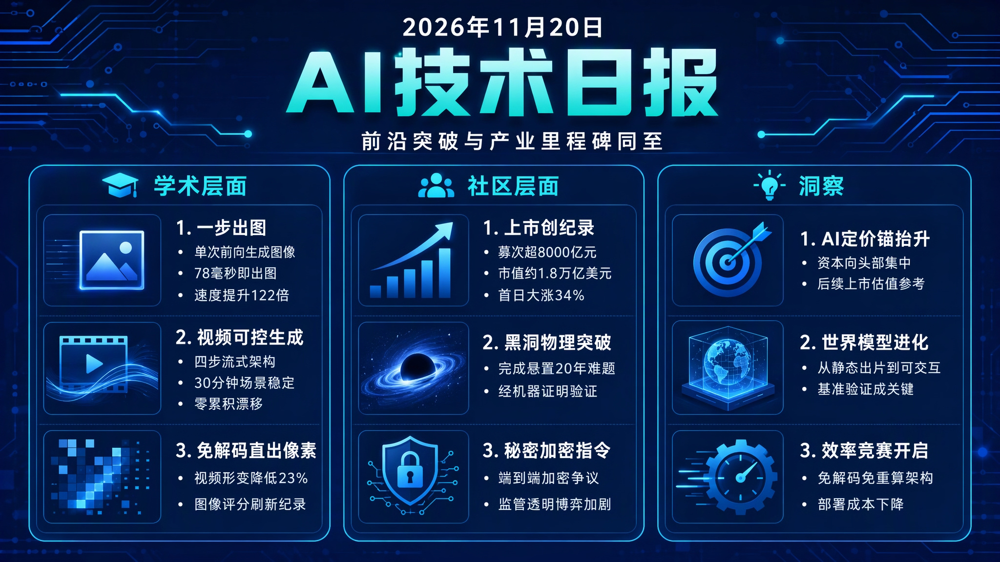

# 🌅 破晓 AI 早报 · 2026-11-20（周五）

> 数据来源：HuggingFace Daily Papers（2026-11-19 批次，50 篇）· HackerNews TOP 20 · Reddit LocalLLaMA（今日 0 条，跳过）· profile_demo.yaml
> 说明：Reddit 数据源今日返回 0 条，社区部分以 HN 为主；Anthropic 于 11 月 19 日完成纳斯达克上市为今日最大事件。

---

## 📡 学术概览

### Tier 1 · 范式级创新

1. **Jeveration：System One 模型也能\"一步出图\"**

   🔬 领域：基础大模型 · 生成模型 · 热度：HF Daily Papers 2026-11-19 批次 Top 1

   - **一句话核心贡献**：让\"System One 快速决策模型\"（如 Jev）在单个前向传播中高质量生成图像——用共享随机状态协调并行预测保证全局一致性，512×512 图像仅需 78ms，比现有统一生成模型快至 122 倍。
   - **摘要精译**：
     System One 模型（如 Jev）以快速、并行预测的方式返回决策。本文提出 Jeveration，证明同一决策范式也能在单次前向传播中生成高质量图像。核心挑战在于维持全局一致性：单个提示可对应无数合法图像，但并行预测必须收敛为一个连贯整体，因此作者让所有位置共享一个随机状态来协调并行预测，使每次取样产生不同但连贯的图像。
     由于在直接图像监督下模型往往会忽略该状态，作者先学习离散图像编码的分布来引导单遍生成；在文本到图像之外，还把图像到图像生成与稠密预测统一进同一架构，使一个 checkpoint 以一次前向分别支持三种任务。
     实验表明，Jeveration 生成 512×512 图像耗时 78ms，比现有统一模型快至 122 倍，同时保持有竞争力的图像质量与稠密预测性能。
   - **核心创新点**：
     1. 共享随机状态协调并行生成
     2. 离散编码分布引导单遍生成
     3. 三种任务统一单前向架构

   

   
💡 展开详情（方法论 + 实验）

   - **方法细节**：基于冻结的视觉语言模型（Jev），重用其视觉语义知识做整体图像生成；所有位置共享随机隐状态作为协调变量，先学习离散图像码分布（distribution over discrete image codes）引导单遍生成，再统一 T2I / I2I / 稠密预测三任务。
   - **实验结果**：512×512 图像 78ms，较现有统一模型快至 122 倍，图像质量与稠密预测性能保持竞争力。
   - **局限性**：论文主要在 512×512 分辨率验证，更高分辨率与更长生成序列的表现待考察。
   - **链接**：https://arxiv.org/abs/2611.24738

   

2. **ALIVE：让流式视频模型\"主动交互\"**

   🔬 领域：视频生成 · 视频理解 · 热度：HF Daily Papers 2026-11-19 批次

   - **一句话核心贡献**：构建可主动监控、协调流式任务、主动追问反馈的交互式流式视频模型——两阶段训练（对比 SFT 288K + RL 3K，RL 用行为对齐信用分配 BACA），在四个公开基准与新提出的 FSI-Bench 上综合得分全部领先。
   - **摘要精译**：
     流式视频大模型能持续观察世界，却常常孤立地处理每个用户请求。ALIVE 引入交互式流式视频模型，支持主动监控、流式任务协调与寻求反馈的交互。
     训练分两阶段：对比监督微调（SFT）教模型\"何时、如何回应\"；强化学习（RL）结合行为对齐信用分配（BACA），融合轨迹级与局部优势来细化多轮交互中的决策、回应与沉默时机。
     作者还提出 FSI-Bench 基准评测主动反馈寻求与后续任务完成；ALIVE 在四个公开基准与 FSI-Bench 上综合得分最高，展示了强大的流式理解与交互能力。
   - **核心创新点**：
     1. 主动监控+流式任务协调范式
     2. 行为对齐信用分配 RL（BACA）
     3. 新基准 FSI-Bench 评测交互

   

   
💡 展开详情（方法论 + 实验）

   - **方法细节**：ALIVE-SFT-288K（对比 SFT 学习响应时机与内容）+ ALIVE-RL-3K（BACA 把轨迹级与局部优势结合，对决策/回应/沉默做细粒度优化）；FSI-Bench 覆盖主动询问与后续任务完成。
   - **实验结果**：对比模型在四个公开基准 + FSI-Bench 上综合得分最高（论文未披露单项数字，以相对排名表述）。
   - **局限性**：训练数据规模（RL 仅 3K）相对有限，长时段流式交互的稳定性与真实场景可用性仍需更大规模验证。
   - **链接**：https://arxiv.org/abs/2611.21366

   

3. **Code World Model 2.0：可控视频生成走向\"无限\"**

   🔬 领域：视频生成 · 世界模型 · 热度：HF Daily Papers 2026-11-19 批次

   - **一句话核心贡献**：提出 Invoker-Render 视频生成架构——双向创建模型 + 因果四步流式模型共享统一条件接口，配合渐进强制（ProForcing）训练法，支持 30 分钟赛车场景滚动生成且场景与主体外观稳定保持。
   - **摘要精译**：
     视觉代理把显式世界状态模拟与逼真视频合成解耦，为离线片段创作与实时交互流提供可控接口。实用渲染器需应对两个挑战：上游代理从粗略布局到精细关节几何不一；流式推理须在少量因果步内运行且不随自生成历史累积漂移。
     Invoker-Render 在约 200 小时的多粒度对齐语料上训练，在提供精细几何约束时予以遵循、仅提供粗略代理时合成合理局部运动，支持运行时选择输入细节级别；为连接双向创建与实时流式，作者提出渐进强制（ProForcing）：先训练因果预测器，蒸馏为四步渲染器并基于训练视频历史训练，随后切换为连续自生成 rollout。
     实验展示跨代理家族、粒度与相机路径的灵活控制，持续优于近期流式基线，并实现 30 分钟赛车 rollout 稳定保持场景与主体外观。
   - **核心创新点**：
     1. 双向创建+四步流式统一接口
     2. ProForcing 渐进式自生成训练
     3. 30 分钟滚动生成稳定无漂移

   

   
💡 展开详情（方法论 + 实验）

   - **方法细节**：Invoker-Render = 双向创建模型（bidirectional creation）+ 因果四步流式模型（causal four-step streaming），共享 structural proxies / appearance reference / language 三通道条件；ProForcing 先蒸馏已训练历史的四步渲染器，再切到自生成 rollout；流水线服务栈支撑高效流式推理。
   - **实验结果**：约 200 小时对齐语料；跨代理家族/粒度/相机路径灵活可控；稳定 30 分钟 racing rollout 保持场景与主体外观（无累积漂移）。
   - **局限性**：四步因果生成在极端复杂动作与长时交互物理一致性上仍有待验证。
   - **链接**：https://arxiv.org/abs/2611.22925

   

4. **Decoding Without a Decoder：扩散 Transformer 直出像素**

   🔬 领域：生成模型 · 视频生成 · 热度：HF Daily Papers 2026-11-19 批次

   - **一句话核心贡献**：让微调的扩散 Transformer 通过线性头直接输出最终像素、无需解码器——去噪头继续驱动采样、新 DWD 头在末步预测像素，在 Wan 视频生成上降低 23% 形变误差，ImageNet FID 从 1.55 降至 1.43（像素流模型新 SOTA）。
   - **摘要精译**：
     潜空间扩散模型依赖解码器把去噪后的隐表示映射为像素，增加复杂度与推理成本。DWD（Decoding Without a Decoder）让微调后的扩散 Transformer 通过线性头直接产出最终像素。
     与此前方法不同，DWD 分离两种角色：原去噪头继续驱动采样过程，新增 DWD 头在最后一步预测像素——仅微调最后几个 Transformer 块、以像素质量损失训练 DWD 头，同时锚定去噪头到预训练模型保持采样轨迹。
     在潜空间图像与视频生成器上，DWD 移除解码器并降低推理成本，同时维持甚至提升像素质量：Wan 视频生成中显著减少细节失真与闪烁（形变误差 -23%）；同样的分离也改进本就无解码器的像素扩散模型，ImageNet FID 从 1.55 到 1.43，成为像素流模型新 SOTA。
   - **核心创新点**：
     1. 线性头直出像素免解码器
     2. 去噪头与 DWD 头角色分离
     3. 只微调末几层保持轨迹

   

   
💡 展开详情（方法论 + 实验）

   - **方法细节**：去噪头负责采样驱动，DWD 头在最终步以像素质量损失（pixel quality losses）训练；通过锚定（anchoring）去噪头到预训练模型避免采样轨迹偏移，仅微调最后若干 Transformer 块，训练成本可控。
   - **实验结果**：Wan 视频生成形变误差降低 23%、细节失真与闪烁显著减少；ImageNet FID 1.55 → 1.43，像素流模型新 SOTA。
   - **局限性**：DWD 头的预测质量与生成分辨率、长视频长度之间的扩展性仍需更多验证。
   - **链接**：https://arxiv.org/abs/2611.22287

   

5. **HINT-WAM：用\"事后视频\"自我蒸馏，机器人操纵更可靠**

   🔬 领域：具身智能 · 世界动作模型 · 热度：HF Daily Papers 2026-11-19 批次

   - **一句话核心贡献**：提出首个 on-policy 自蒸馏框架 HINT-WAM——用演示的未来视频作为特权信息监督动作专家自身采样轨迹，无需环境奖励或仿真交互，以能量分数进行分布级蒸馏，解决离线 SFT 与 on-policy RL 两派方法的固有缺陷。
   - **摘要精译**：
     世界动作模型（WAM）以动作生成耦合未来视觉动力学预测，在机器人操作中展现出良好泛化与数据效率，但现有后训练方法难以转化为可靠的任务执行：离线监督微调在专家轨迹上提供密集监督，其流匹配动作专家却只在噪声演示动作上训练、从未见过自身采样器产生的中间状态；on-policy 强化学习以策略自身行为训练，但稀疏任务奖励使探索与信用分配困难。
     HINT-WAM 是首个 on-policy 自蒸馏框架：把演示的未来视频作为特权信息作为监督信号，动作专家在其自身采样轨迹上被监督——学生沿自己的去噪轨迹生成动作，在轨迹各状态上同一模型额外以事后信息作为教师，提供条件动作分布作为密集训练目标，而学生只看到部署时输入、无需环境奖励或仿真交互。
     为把监督迁移到流匹配动作专家，HINT-WAM 以能量分数进行分布级蒸馏，匹配教师动作分布而非回归速度场；项目主页见 https://tuandattt.github.io/hintwam/ 。
   - **核心创新点**：
     1. on-policy 自蒸馏免环境奖励
     2. 事后视频作特权信息监督
     3. 能量分数分布级蒸馏

   

   
💡 展开详情（方法论 + 实验）

   - **方法细节**：学生沿自身去噪轨迹生成动作；同模型在中间状态上加事后（hindsight 未来视频）条件充当教师，给出条件动作分布作为密集目标；学生部署时仅见当前输入；用能量分数（energy score）做分布级蒸馏而非回归速度场，适配 flow-matching 动作专家。
   - **实验结果**：论文主体为方法论与框架验证，实验细节与数值见论文正文（项目页 tuandattt.github.io/hintwam）。
   - **局限性**：依赖演示视频质量，教师信号质量受演示数据覆盖度影响；长时间任务上的持续性需进一步验证。
   - **链接**：https://arxiv.org/abs/2611.24789

   

6. **WorldRuler：可配置规则下的交互世界建模**

   🔬 领域：世界模型 · 视频生成 · 热度：HF Daily Papers 2026-11-19 批次

   - **一句话核心贡献**：提出 WorldRuler 让生成式世界模型遵循用户自定义规则——用可执行 3D 规则图组织规则定义与对象状态、闭环串联规则执行/视频生成/感知反馈，规则可保存加载且对未见对象也能准确实现规则诱导变化。
   - **摘要精译**：
     规则决定玩家行为如何改变交互世界，不同规则在相似场景与动作空间中产生截然不同的游戏体验；可定制玩法要求生成式世界模型遵循超越真实世界行为的用户定义规则，这带来两个挑战：规则-状态持久性（保存加载后仍遵循既定规则）与规则到视觉实现（在指定对象与属性上准确实现规则变化，尤其当对象不可见时）。
     WorldRuler 在可执行 3D 规则图中组织规则定义、依赖与对象状态，闭环连接规则执行、视频生成与感知反馈；动态对象绑定把规则指定实体接地到视觉实例，并用存储状态约束其首次出现的生成。
     作者引入对象属性状态替换与反事实重建训练，实现精确属性控制与兼容的外观/运动变化，同时限制无关内容干扰；用 GTA-V 与 Habitat 构建自动化数据采集与标注管线，产出规则驱动交互数据集 RuleVerse（含规则在对象可见前生效的案例），实验验证保存-加载下的规则状态一致性与规则结果准确实现。
   - **核心创新点**：
     1. 可执行 3D 规则图持久化
     2. 动态对象绑定+状态约束生成
     3. RuleVerse 自动化数据管线

   

   
💡 展开详情（方法论 + 实验）

   - **方法细节**：3D 规则图支持规则+状态联合保存恢复；动态对象绑定（dynamic object binding）把规则实体接地到视觉实例，用存储状态约束首次出现生成；对象属性状态替换 + 反事实重建训练保证精确属性控制；数据来自 GTA-V 与 Habitat 自动化管线。
   - **实验结果**：WorldRuler 在保存加载后的规则状态一致性、指定对象与属性的规则结果实现上有效性显著（规则在对象出现前即生效的案例亦有覆盖）。
   - **局限性**：规则图构建依赖仿真环境（GTA-V/Habitat），向真实开放世界规则泛化有待扩展。
   - **链接**：https://arxiv.org/abs/2611.24869

   

### Tier 2 · 工程改进与垂直应用

7. **StrideWorld：交互视频世界模型的新基准**（HF 2026-11-19 批次 · 视频世界模型）
    针对现有基准"基准参考在评测后才拟合"的漏洞，用固定场景几何与动作步长作为锚点评测场景刚性与动作一致性：140 个起始视点生成的视频中，除一个模型外全部在相机移动时使场景变形，偏移最高达刚性渲染的 7.3 倍；多数模型沿组合路线中途停滞。仅以场景深度缩放指令的两个模型让多数路线接近预测位置。
    🔗 https://arxiv.org/abs/2611.24408

8. **Late Entry in Looped Language Models：推理加速新思路**（HF 2026-11-19 批次 · 推理 · ML 系统）
    提出"晚进入"解码策略（新 token 跳过前几遍直接进入深层缓存的最后 K 遍），配合 Wake 验证：Ouro-2.6B（T=4）K=2 时达贪婪精确解码 5.2 倍加速（GSM8K 上比 K=4 块解码快 26%）；Huginn-3.5B 在 T=64 时贪婪精确加速 8.4 倍、容忍误差时 10.6–12.5 倍。
    🔗 https://arxiv.org/abs/2611.24576

9. **Game2Player：环境-玩家协同扩增视觉 Agent 游戏经验**（HF 2026-11-19 批次 · 视觉 Agent · 具身）
    构建 568 个可验证网页游戏（3,436 任务）、采集 15.7K 轨迹（307 小时游戏）；进度加权 SFT 训练的 Game2Player-9B 在 PlayerBench 进度从 14.3% 提升至 31.2%、外部 GameWorld 基准从 30.0% 提升至 53.1%。
    🔗 https://arxiv.org/abs/2611.24154

10. **CurvDelta：低曲率 Delta 建模，适配不掉能力**（HF 2026-11-19 批次 · 基础模型 · 后训练）
    把能力保留约束显式写入模型更新参数化——通过 K-FAC 近似曲率构建低曲率空间，数学推理/代码生成既保持竞争力又不退化通用能力；知识遗忘上 TOFU/MUSE 的"遗忘-保留"平衡优于基线，保留能力接近从头重训参考。
    🔗 https://arxiv.org/abs/2611.24654

---

## 🔥 社区速递

### Tier 1 · 高热度热点

1. **Anthropic 纳斯达克上市：史上最大 IPO 首日大涨 34%**

   🔥 热度信号：HackerNews Score 788 · Top 1 · 来源：Reuters / CNBC

   - **一句话核心**：Anthropic 于 11 月 19 日在纳斯达克以每股 $83 上市，首日收涨 34%（盘中一度 $111），收盘市值约 $1.8 万亿；基础募资约 $813 亿，行使超额配售后达 $935 亿，超越 SpaceX 6 月的 $857 亿成为史上最大 IPO。
   - **核心共识**：
     - 营收增速惊人——2026 年前九个月营收约 $332.4 亿，同比增长约 1200%，年化营收约 $810 亿，投资者因此给出极高估值；
     - 首日成交超 6.4 亿股、散户配售 15–20% 远超常态，AI 资产成为市场追逐主线；
     - Dario Amodei 表态"under promise and over deliver"，强调上市后财务实力增强更有利于安全承诺。
   - **主要争议**：净亏损 $1040 亿（其中约 $943 亿为非现金公允价值变动）使部分投资者质疑估值泡沫——高营收增速能否支撑 $1.8 万亿市值？
   - **影响评估**：AI 一级市场的定价锚被大幅抬高，OpenAI、xAI 等后续上市的估值预期与融资谈判空间被打开；对创业者而言，资本将更集中流向头部前沿实验室。
   - 🔗 [Reuters 报道](https://www.reuters.com/business/finance/anthropics-historic-debut-put-ais-promise-peril-wall-st-test-2026-11-19/)

2. **Claude 解决黑洞物理两个开放问题**

   🔥 热度信号：HackerNews Score 328 · Top 9 · 来源：Anthropic 官方研究博客

   - **一句话核心**：Claude Fable 5.2 用多个自身副本组成的 agent 小组，完成悬置 20+ 年的 Hawking-Page 相变三圈计算（数千费曼图），并首次用谱曲线工具证明模 bootstrap 的最轻黑洞质量上限 c/Λ（Λ≈9.1266）且为最优。
   - **核心共识**：
     - 第一个问题结论：相变是突变的（abrupt），与强耦合端霍金-佩奇结果一致，说明黑洞形成深植于底层量子理论而非相对论特例；
     - 第二个问题用此前从未应用于此的 spectral curve 方法，结果经 Lean 计算机证明检查器正式验证，可信度获社区认可；
     - 8 月发起 22 个开放问题、每个设独立 agent 运行约 6 周，人类物理学家核查每一项主要结果，展示"AI 科研群组"新范式。
   - **主要争议**：两个结果不直接描述我们的宇宙、也无实际应用——前沿理论探索的投入产出是否值得？
   - **影响评估**：验证了 LLM 在长周期、高计算量的理论推导任务上可独立产出经机器验证的新结果，"AI 研究员群组"从演示走向可复现产出，对数学/物理研究流程的影响值得关注。
   - 🔗 [Anthropic 研究博客](https://www.anthropic.com/research/claude-black-hole-physics)

3. **英国政府被迫承认向 Apple 发出秘密加密指令**

   🔥 热度信号：HackerNews Score 436 · Top 4 · 来源：Mac Anorak

   - **一句话核心**：英国政府被迫承认曾向 Apple 发出秘密加密命令（秘密技术要求通知），要求削弱特定用户数据的端到端加密保护，事件曝光引发隐私与安全社区强烈反应。
   - **核心共识**：
     - 秘密加密命令与"全球加密弱化"担忧直接相关，社区普遍认为此类后门会削弱所有人的安全保障；
     - 政府被迫承认说明法律程序压力奏效，透明化是约束此类命令的关键；
     - 与"AI 时代数据安全"议题叠加，端到端加密的立法与监管走向成为焦点。
   - **主要争议**：国家安全诉求与加密隐私保护的边界如何划定？秘密命令的司法审查是否足够？
   - **影响评估**：对依赖端到端加密的 AI 应用与企业数据治理是直接政策信号——监管透明度与加密强度可能在未来形成更激烈的博弈。
   - 🔗 [Mac Anorak 报道](https://macanorak.com/uk-government-forced-to-admit-it-issued-apple-a-secret-encryption-order/)

### Tier 2 · 值得关注

4. **Pete Warden 谈本地 AI、开源模型与语音接口**（HN Score 197 · Top 15）
   TinyML 代表人物 Pete Warden 在播客访谈中分享：本地小模型的实用化路线、开源模型地位的上升、语音作为新一代交互接口的前景，以及端侧 AI 硬件的发展方向——"模型越小越聪明"的本地化叙事持续获得关注。
   🔗 https://thedataexchange.media/pete-warden-moonshine/

5. **Ruby2ßhell：预认证 RCE 攻破原生 Rails**（HN Score 371 · Top 6）
   安全研究员披露 Ruby 生态一个影响预认证阶段的严重漏洞（RCE，原生 Rails 栈），并发布利用细节——框架默认配置的边界再一次被挑战，社区讨论集中在框架厂商默认安全策略与依赖审计。
   🔗 https://verialabs.com/ruby2shell/

---

## 💰 商业动态

1. **Anthropic 纳斯达克上市：史上最大 IPO，市值约 $1.8 万亿**：发行价每股 $83，首日收涨 34%（盘中一度 $111），收盘市值约 $1.8 万亿（全面稀释），一度突破 $2 万亿，成为美国第 7 大市值公司；首日成交超 6.4 亿股、散户配售 15–20%（常态仅 5–10%）。基础募资约 $813 亿，行使超额配售（额外 1.47 亿股约 $122 亿）后达 $935 亿，超越 SpaceX 6 月 $857 亿纪录；承销费用 $5.5 亿（Goldman Sachs / Morgan Stanley 领衔）。财务：2026 年前九个月营收约 $332.4 亿（同比约 +1200%），10 月底年化营收约 $810 亿；净亏损 $1040 亿，其中约 $943 亿为可转换票据公允价值变动（非现金）。七大联合创始人通过 Founder LLC 持有 50.1% 投票权；Dario 称一直以"200 英里/小时"的能力储备、"90 英里/小时"的速度推进。
   🔗 [CNBC 直播页](https://www.cnbc.com/2026/11/19/anthropic-ipo-ant-live-updates.html)

2. **Anthropic 也是 SpaceX 最大客户**：双方协议总额最高达 $1205 亿（至 2029 年，全面交付后每月约 $31 亿）——SpaceX 6 月刚以 $857 亿创下 IPO 纪录，如今被其最大客户超越，AI 算力支出的规模效应与资本市场定价形成强耦合。
   🔗 [Reuters](https://www.reuters.com/business/finance/anthropics-historic-debut-put-ais-promise-peril-wall-st-test-2026-11-19/)

3. **Claude Fable 5.2 研究突破形成产品势能**：Anthropic 同日发布 Claude 解决黑洞物理两个开放问题的研究（此前 11 月 9 日刚发布 Fable 5.2 / Mythos 5.2 与 $9000 亿超大规模算力承诺），上市首日即以"前沿研究+算力基建"双重叙事获得市场认可——理论突破与商业路径互为背书。
   🔗 [Anthropic 研究博客](https://www.anthropic.com/research/claude-black-hole-physics)

---

## 📊 今日总结

1. **AI 资本市场定价锚被大幅抬高**
   - **现象**：Anthropic 以史上最大 IPO（$813–935 亿募资）登陆纳斯达克，首日市值约 $1.8 万亿、年化营收约 $810 亿（同比约 +1200%），超越 SpaceX 纪录，成为美国第 7 大市值公司；同周 Claude Fable 5.2 解决两个黑洞物理开放问题、$9000 亿算力承诺同步发酵。
   - **逻辑**：前沿实验室的营收增速（1200%）与算力基建支出（SpaceX 协议 $1205 亿）共同支撑极高估值；资本市场愿意为"模型-算力-研究"三位一体的稀缺资产给出价格，而巨额非现金亏损被市场视为账面而非现金流风险。
   - **预测**：OpenAI、xAI 等后续 IPO 将以 Anthropic 市值作为估值锚，AI 一级市场资金加速向头部集中；同时高估值把"营收持续高增"写进定价，任何增速回落都可能引发剧烈波动。

2. **世界模型从\"画\"走向\"可交互、可验证\"**
   - **现象**：今日 HF 批次多篇同级推进：Code World Model 2.0 实现 30 分钟赛车场景稳定滚动生成，WorldRuler 让生成世界遵守可保存的用户规则，StrideWorld 用固定几何/步长锚点揭穿多数模型场景变形（偏移最高 7.3 倍），ALIVE 把流式视频模型推向主动交互。
   - **逻辑**：视频生成从\"静态出片\"向\"可持续探索的模拟环境\"演进，产业共识逐步转向世界模型；而世界模型要可信就必须可验证，StrideWorld 式固定锚点评测正是把\"交互世界\"从演示推向基准化测量的关键一步。
   - **预测**：交互式、规则可控、长时稳定会成为视频生成模型的核心竞争指标，评测基准（Scene Rigidity/Action Consistency 类）将随模型一起迭代；游戏与仿真行业可能率先采纳\"规则可配置的世界模拟\"能力。

3. **生成效率与推理效率双线突破**
   - **现象**：Jeveration 让 System One 模型单前向生成 512×512 图像仅 78ms（快至 122 倍），Decoding Without a Decoder 移除解码器还将 Wan 视频形变误差降低 23%、ImageNet FID 刷至 1.43（像素流 SOTA），Late Entry 使循环语言模型推理最高提速 8.4–12.5 倍。
   - **逻辑**：算力竞争进入\"每瓦特产出\"维度：生成侧去掉冗余模块（解码器）、推理侧利用深度缓存与新解码调度，都是在不迭代更大模型的前提下压成本与延迟；效率优化对边际成本敏感的商业部署（视频生成、长推理）价值陡增。
   - **预测**：视频生成与推理的\"免解码器/免重算\"架构将加速进入产品线，端点推理与边缘部署的成本结构随之改善；效率指标（FID、形变误差、加速倍数）会成为模型选型的公开竞争点。
